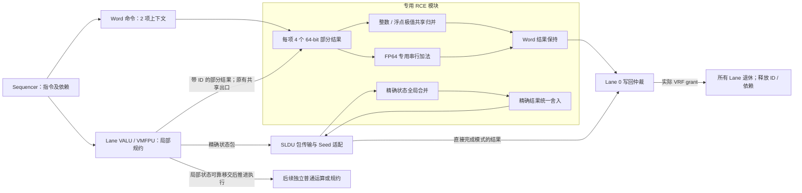

# 专用 Reduction Completion Engine：实现与验证记录

本文记录起点为 `43185a5c` 的 RCE 开发工作；实现原在 `reduction-rce` 开发，合入分支为 `reduction-optimization`。验证证据中的开发分支名保留原始测试归属。当前是分阶段开发记录，不能代替最终验收。综合不在本次执行范围内；面积、时序和功耗只能讨论结构上的代价，尚无测量结论。文末按阶段记录停顿审查、精确累加空拍旁路及收尾吞吐改进；各阶段的构建和测试结果分别归档，不能混算。

2026-10-10 补充架构验证发现一项尚未修复的异常语义缺陷：`vstart=VL=4` 时，规约被共用译码路径当作空操作处理，没有触发 RVV 要求的非法指令异常。RCE 开启和关闭配置均复现。常规运算与混合调度的通过记录不能据此推广为完整 RVV 架构合规；详见“补充架构正确性验证”一节。

## 当前实现边界

| 内容 | 当前状态 |
|---|---|
| 独立整数收尾：求和、宽化求和、逻辑、带符号及无符号极值 | RCE 模块已实现并接入 Ara；当前整数阶段的 ISA 与定向回归通过 |
| FP16/FP32/FP64 min/max 收尾 | 已接入 VMFPU；138 项 IEEE 回归和首个混合程序通过，覆盖仍在扩展 |
| 原有 FP16/FP32 精确无序求和 | 已增加 RCE 内部精确后端及独立直接写回开关；后端迁移已验证，直接写回阶段仍在扩展回归 |
| FP64 无序求和及宽化到 FP64 | 已增加固定 ADD 的专用串行收尾通路；2000 项模块检查及 140 项整机边界通过，v2 已修复并验证普通结果饱和标志归属，完整覆盖未完成 |
| 有序浮点求和 | 保留原顺序路径，不送入无序归并器 |
| 整数规约与普通 VALU 指令重叠 | 已实现独立开关；功能回归和首个同 ELF 周期消融通过 |
| 精确无序求和与普通 VMFPU 指令重叠 | 已接通独立完成所有权；加法/乘法/比较及首个同 ELF 三配置消融通过，完整普通运算覆盖未完成 |
| 整数 Late-Bound Seed | 已接入独立开关；整数 RCE 生产者到整数规约消费者可后移 seed，须覆盖消费者 seed 位宽；114 项矩阵及相关性/版本回绕通过 |
| 不同 VL/SEW/整数规约类型的收尾上下文 | 每项独立保存元数据；异构 SEW 程序通过，并直接观察到 19 个不同位宽 Word 上下文并存周期；不代表任意异构发射均无阻塞 |
| 标量 LMUL、组内 seed RAW、普通 FPU 返回标签 | 已修复对应反例；v7 ISA10 通过，v9 原 VID/LMUL 连续切换 12 项通过 |
| 共享浮点 CSR 顺序 | 已移植必要的忙状态互锁；v8 原失败 ELF 的 25 项舍入/异常检查通过 |
| 共享 word 数据通路与输入隔离 | 两个独立默认关闭开关；v2 通过 20,000 项 word、2000 项 FP64 模块检查及 8 个整机程序，同源同 ELF 周期不变；选定信号的翻转改善已测，面积/Fmax/功耗未测 |
| 精确局部累加的无舍入空拍旁路 | 已实现默认关闭的独立开关；新旧多拍状态/延迟对照、独立算术模型及 50 程序整机回归通过，具体周期收益见文末 |

三个收尾吞吐开关另见文末：普通结果队列同周期回收、Word 上下文周转、精确出口提前释放均已实现，各自独立消融；默认行为与本阶段选定实验配置须分开看。

“模块具备接口”与“整机已经使用该接口”是两种不同状态。当前整数 Late Seed 已有整机接线，但 FP64、浮点 min/max 的 WAIT 接口尚未接入对应调度，普通非规约生产者也不走新的整数直接转发。后文按阶段保留历史结果；当前能力以本节及最后的阶段记录为准。

## 数据流与所有权



图中 Word 后端与精确后端位于同一个 RCE 模块内，各自保存接收与收尾状态。精确路径继续经过 SLDU 的传输和完成适配，但最终合并算术与统一舍入在 RCE 内完成；它不再借用普通 Lane FPU 做尾部计算。有序浮点求和保留原 Lane/SLDU 顺序 token 路径，不进入图中的无序归并器。

局部计算结束时，VALU 进入 `RCE_SEND`，保持部分结果、指令 ID、原始 seed 和源活动信息，直到 RCE 接收。接收之前，Lane 必须保留这些数据；接收之后，RCE 接管收尾状态，VALU 可以推进 issue 指针。此时 commit 指针仍然保留旧规约，相关 RAW/WAR/WAW 仍由既有依赖机制约束。

当前整机配置采用两个 RCE 上下文，每项保存四个 64-bit 局部值、操作码、结果 EEW、目的寄存器及版本、接收位图、活动位图和 seed 元数据。部分结果数据寄存器共 512 bit，此数字不包含描述符、seed、flags、累计值及输出保持寄存器。部分结果按 ID 匹配到上下文，不能根据到达先后猜测归属。

VALU 新增独立的局部累计值寄存器，使 RCE 规约不占用普通结果 FIFO 的槽位。收尾结果通过独立仲裁进入 Lane 0 原有 VRF 写口，不绕过 VRF grant。只有所有 Lane 都确认该结果对应各自 commit 头，且 Lane 0 获得写回授权，才广播退休事件。这样，后继普通结果即使填满普通 FIFO，也不会挡住旧规约所需的结果存储槽。

RCE 在物理数据传输上复用 Lane 的 SLDU/ADDRGEN 出口。出口队列新增 RCE 类型，在局部移交时释放该条出口所有权；它不再等整个规约退休。因此，此阶段没有新增四条独立 64-bit Lane 间网络，也没有消除已有出口与 Slide、索引地址生成之间的结构冲突。

第一阶段保留 Sequencer 原有的两项 Slide/规约共享额度。SLDU 和 RCE 若同周期都准备返回完成事件，先处理 SLDU，RCE 保持输出等待，避免原有计数逻辑漏掉第二个事件。这是有意保留的调度限制，不是独立 Completion 队列已经消除了 SLDU 竞争。

## 专用运算路径

`hardware/src/reduction/reduction_completion_engine.sv` 包含上下文、归并运算和输出保持控制。其归并逻辑不请求普通 Lane 的 ALU/FPU。控制阶段为 `IDLE → MERGE → FOLD → SEED → HOLD`，同一套组合归并逻辑在多个周期内处理跨 Lane、字内水平合并和必要的 seed 合并。

对于四个 Lane，`MERGE` 依次合并其余三个 Lane 的 64-bit SIMD 部分结果。之后 EW32、EW16、EW8 分别执行一、二、三级字内水平合并；EW64 无须字内折叠。整数求和按有效结果宽度截断，宽化求和使用 dispatcher 已转换的结果 EEW，而不是再次扩展一次。逻辑和极值使用各自运算规则。该组织减少并行树的复制，但串行收尾吞吐能力有限，必须通过测量判断是否成为新的瓶颈。

浮点 min/max 使用指数、尾数和符号位分类及大小比较，显式处理 NaN、sNaN、无穷和 ±0，没有新增浮点加法器或完整 FPU。所有不活动位置应由生产者提供正确的中性值；全局源活动位另外决定“没有任何有效源元素”时直接复制原始 seed 的行为。空 Lane 与架构 VL=0 不同：前者仍需发送一个局部状态，后者不写目的寄存器。目前整机 VL=0 保留原路径，模块级 VL=0 则测试不写回的完成记录。

seed 有三种表示：已经由 Lane 嵌入、由命令提供且在末尾合并、等待指定生产者后绑定。等待模式要求生产者 ID、寄存器号、寄存器版本全部匹配。普通路径由 Lane 0 随部分结果发送原始 seed；启用整数 Late Seed 且满足生产者/位宽条件时使用第三种，RCE 等真实写回事件绑定原始位模式。两者都保证全 Mask 返回正确 seed，避免把局部中性填充值当作 seed。

## 构建与消融

在既有四 Lane 完整优化配置基础上，整数阶段新增两个默认关闭的开关；后续浮点与精确后端开关见各阶段记录：

- `reduction_rce_int=1`：整数局部结果转入专用 RCE。
- `reduction_rce_mixed=1`：允许旧 RCE 规约未退休时，后续符合现有依赖约束的普通指令开始执行；要求至少开启一种 RCE 后端。整数接入作用于 VALU，浮点接入作用于 VMFPU。

验收分别构建原路径、仅 RCE、RCE 加混合执行三个配置，使用同一份冻结 ELF。首个微基准已完成三配置对照，详见下文；尚无混合工作负载总体收益结论。普通结果队列深度、VRF 写口、Mask 通路和共享通信出口仍可能限制实际重叠。

## 已有证据与首个反例

`hardware/build/rce/word_v2/manifest.json` 记录模块级 2640 例通过。参考值来自 Python 标量模型，覆盖整数和浮点 min/max、三种 seed 模式、空输入、NaN/无穷/±0、不同 Lane 到达次序、两个并存上下文、输出背压和 ID 重用。这不等价于 VMFPU 整机已经验收；错误 seed 版本的专门拒绝测试在后续 word_v3 中补充。

首次整数整机接入 `int_integration_v1` 在 `perf_integer_reduction_stream_probe` 中失败：每组四条中的第四条只返回 seed。冻结 ELF 和日志保留在 `int_focused_v1`，短窗口波形保留在 `int_first_failure_wave`。417.5 ns 的 Lane 0 周期中，旧规约成功移交，同时接收新规约；新指令已经进入局部规约状态，但元素计数仍为零。420.5 ns 消费第一个操作数时所有字节被当作不活动，下一周期便发送了只有 seed 的结果。

修复在局部移交后使用接收新指令之后的队列描述符重新初始化元素计数，覆盖同周期接收这一边界。`int_integration_v2` 编译通过，原失败程序在 `int_focused_v2` 通过。后续整机结果按对应 manifest 记录，不以“仿真正常退出”代替明确成功标志。

第二个定向反例由 `reduction_rce_ownership` 捕获：`vredsum → vmseq → vcpop` 的 Mask 出口没有等待旧 RCE 规约提交。396.5–399.5 ns，Mask 结果握手错误地扣减了旧规约的 commit 元素数；401.5 ns 旧规约退休后，新 commit 头却重新等待已经消费掉的结果，随后触发结果 ID 与 commit 头不符的断言。修复使 Mask 出口与普通 VRF 出口一样遵守 RCE 头部所有权。原实现通过此程序，修复前 `ownership_v2` 失败，修复后 `ownership_v3` 明确成功，包含 Mask 结果以及后续饱和结果、`vxsat` 检查。

`integer_isa_v2` 的十个整数规约 ISA 程序全部通过。它验证的是修复第一处交接错误后的版本，不能替代后续混合出口修改的回归。`word_v3` 又补充了错误 seed 版本广播的拒绝检查，2640 例通过。`mixed_baseline_v1` 和 `int_focused_v2` 中的长混合程序都在 300 秒宿主时间限制下中止，结束前仍有指令推进；两次均不计为通过，后续保留相同 ELF、延长宿主运行时限重测。

## 第一组可归因的周期对照

同一 RTL 源码分别构建 `off_v3`、`int_no_mixed_v3`、`int_integration_v3`，外围和测试区间相同。`perf_rce_mixed_probe` 的同一 ELF SHA-256 为 `215977c12b81d3929cb7abe6def81adedd95796e7cedb5ecae14cad4e0f7ffe5`。测量区间包含 32 组 `vredsum.vs + vadd.vv`，VL=32、SEW=32，边界通过 vector CSR 读等待向量后端完成，用用户态 `cycle` CSR 计数。三种配置都检查最终结果成功。

| 配置 | 周期 | 相对原路径 |
|---|---:|---:|
| 原有完整优化，关闭 RCE | 586 | 基准 |
| 专用整数 RCE，关闭混合执行 | 617 | 周期增加 5.29% |
| 专用整数 RCE，开启混合执行 | 554 | 周期减少 5.46% |

完整比较见 `hardware/build/rce/perf2_comparison.json`。这些是该程序、该边界下的仿真周期，包含相同的标量边界开销，不能据此声称 Fmax 不变或实际执行时间已经改善。只搬出收尾反而变慢，说明串行 RCE 的额外周期确实有成本；开启混合执行比仅 RCE 少 63 周期，才体现局部资源释放的价值。该单点也不能证明独立规约、长向量及其它混合程序都有收益。

`mixed_profile2_v3/events.json` 给出了 Lane 0 在 380–1000 ns 窗口的逐周期证据：32 次局部结果移交、32 次实际退休，以及 64 个 `alu_state_q == NO_REDUCTION && valu_valid && rce_pending_q != 0` 的普通运算周期。此程序在该区间的普通 VALU 操作就是 `vadd`，因此这不是不同 VFU 原本就有的并行。

第一个周期序列如下，时间指时钟上升沿后信号稳定的周期标签，不表示 VCD 能区分同一时刻内的所有事件区：

| 周期标签 | Lane 0 行为 |
|---|---|
| 409.5 ns | 规约部分结果满足移交握手 |
| 410.5、411.5 ns | 旧规约仍 pending，普通 `vadd` 发射两个数据包 |
| 416.5 ns | 旧规约结果获 VRF grant，广播退休 |
| 426.5 ns | 下一条规约移交；之后按相同节奏重叠 |

每条普通加法在旧规约退休前只提前处理两个数据包，正好对应当前普通结果 FIFO 的两项深度。这是已观察到的结构约束；没有为了追求更大加速直接扩大 FIFO，后续需比较增加缓冲、改变写回策略和保持原深度的代价。

性能程序的第一版误读了用户态无权访问的 `mcycle` CSR，三种配置均在进入目标区间前触发非法指令，旧 `perf_*v3` 记录无效但保留。修正为运行时已有用法的 `cycle` 后，才生成上述 `perf2_*` 证据；没有更改数值预期或禁用异常检查。

`mixed_v3` 已完整通过 108 个混合序列，覆盖 e8/e16/e32/e64、九种长度、短向量空 Lane、规约后独立 `vadd`、后继规约的真实 seed RAW、普通 `vadd` 的真实源向量 RAW，以及整个普通结果向量和 tail 检查。`integer_isa_v3` 重跑十类整数规约程序也全部通过。

## 共享出口测试暴露的继承缺陷

`reduction_rce_shared` 交错整数规约、普通 Slide、索引 Load 和 Store，并检查 Load→规约 RAW。`shared_off_v3` 和 `shared_int_integration_v3` 都出现了 Slide 最后一项为未知值，虽然软件打印 PASS，脚本根据未知数据断言将两次判为失败。给目的寄存器和源组之后的寄存器分别填入 -1、-2 后，两种配置都明确报 `i=31, slide=4294967294`，预期仍为零。此实验区分了“目的末项未写”与“从下一源寄存器越界取值”：实际为后者。

`ara_dsa_signoff_integration` 的 `7d5d1829` 已有相应 VLMAX 补零处理，本分支仅移植了有效源组字节数计算和越界输出补零两部分。SEW 改变元素到字节的映射，LMUL 决定源组边界，包括分数 LMUL；VL 仅限制本条指令写多少目的元素，不能用它截断本来仍合法的源元素。此次移植不包含该分支的其它 Slide 控制重构。后续整机与补充边界结果另列，修复前失败仍保持失败记录。

`shared_off_v4` 与 `shared_int_integration_v4` 使用相同的加毒 ELF，修复后均明确成功且无断言失败。原来的越界预期仍为零，没有缩短 VL 或排除末项。覆盖 SEW 与 LMUL 的独立边界结果见本阶段验收快照。

`mixed_off_v3` 也已完整通过同一 108 序列 ELF，与 `mixed_v3` 对照成立。两次只增加了宿主超时额度，没有改变 ELF、RTL、架构预期或断言。

## 为什么收尾上下文不复制整份指令状态

局部移交之前，Lane 已经消费属于本指令的源数据和 Mask，并把其作用反映到部分结果中。RCE 后续不再读取 Mask 向量，因此保存每个 Lane 的“是否有真实活动源元素”即可判断全局空输入；它不需要复制整份 Mask。这不允许提前释放仍未消费的 Mask，也不意味着 MASKU 的调度限制已经消失。

整数收尾只需知道有效结果 EEW。源 SEW、宽化扩展、LMUL 对寄存器组的影响由 dispatcher、Lane 操作数转换及依赖管理完成；RCE 仍保留目的寄存器号、版本和指令 ID。LMUL 不改变最终只写 `vd[0]` 的事实，但前端 RAW/WAR/WAW 对整个相关源组的约束仍须保持。每个 RCE 上下文保存自己的操作码和 EEW，因而收尾数据通路不要求两条规约形态相同；Lane 前端能否同时提供这些上下文，仍需单独验证操作数和 Mask 所有权，不能由此直接删除兼容检查。

## 下一阶段接入约束

浮点 min/max 接入时，VMFPU 必须先收完局部 FPU 返回及其 flags，再移交最终部分结果；仅源操作数已经发完不足以释放 processing 指针。局部结果、原始 seed、全局活动信息、异常标志必须属于同一个指令 ID。RCE 写回需根据结果类别选择 VALU 或 VMFPU 的归属检查，不能让浮点结果借用整数 commit 头。

现有精确无序求和迁移时，应保留已经验证的 Sparse-Window 解码、精确合并和统一舍入实现，将其作为 RCE 内部后端接入统一完成接口。移动模块边界本身不代表调度已经解耦：只有旧精确状态可靠移交、旧指令写回所有权独立保留、后续普通 FPU 指令可以合法推进时，才能宣称支持该类混合执行。FP64 无序求和尚需独立的数值及资源方案，不能用当前 FP16/FP32 精确后端的测试代替。

整数 Late Seed 还需要将 RCE 的版本化 seed 接口接到真实生产者完成事件，并使 operand requester 能生成不包含 seed 的局部初值。只有精确识别“唯一可延后的依赖就是 seed”后才能移除相应 hazard 位；源向量别名、Mask 依赖、目的版本和提交顺序继续保留。目前模块测试的晚 seed 不构成这部分整机调度已经实现的证据。

## 第三个 RCE 混合执行反例：饱和标志的归属

`reduction_rce_saturation_mask` 让普通 `vsaddu` 的第一个数据包全 mask、第二个数据包全 active，并把两者排在 RCE 规约之后。关闭 RCE 的 `sat_mask_off_v4` 返回 `vxsat=1` 并通过；开启 RCE 的 `sat_mask_int_integration_v4` 返回 `vxsat=0`，但规约数值为正确的 67。旧的全 active 饱和测试没有暴露该问题。

波形 `sat_mask_failure_wave` 中，438.5、439.5 ns 两个普通数据包连续执行，之后结果 FIFO 有两项等待旧规约；440.5 ns 读指针仍指向 byte-enable=0 的第一项。旧代码只有一个每周期更新的 ALU 饱和标志寄存器，因此第二项的标志与第一项的 byte-enable 相与后被抹掉。到 443.5 ns 第二项真正写回时，实时 ALU 标志已经变成其它周期的值。修复将 8-bit 饱和标志随每项普通结果保存，并在该项实际获 VRF/MASKU grant 时按该项 byte-enable 上报；窄化分两次填充同一项时累积标志。新状态只在 RCE 配置使用，关闭时保持原标志路径。

该修复也说明，仅仅让普通算术能够发射还不等于完成混合执行：结果数据、字节使能、目的版本、异常或饱和标志都必须保持共同归属。该修复以 v5 的反例复测为验收，不能沿用 v4 的全 active 测试作为证据。

Slide 边界测试首版加入了当前 ELEN=64 下不支持的 e64/mf2，dispatcher 正确设置 `vill`，随后的向量指令触发非法指令。修正后保留 44 个合法组合，原始失败日志保留；没有更改任何合法组合的预期。异构测试首版的 `vmset.m v0` 读取了未初始化的 v0，在四态仿真中传播未知值；增加显式 v0 初始化后再做相同的 Mask 测试，原失败日志同样保留。

Late Seed 的位宽检查也不能省略。例如前驱只写了 8-bit 的 `vd[0]`，后继却按 16-bit 读取同一寄存器作为 seed，正确 seed 的高 8 bit 来自原寄存器内容；直接转发前驱的低 8-bit 结果并补零会改变程序语义。后续适配器必须检查生产者写入字节是否完整覆盖消费者 seed，或取得正确的合并后 VRF 值，再向 RCE 提交对应版本的完整 seed。当前模块接口假定调用者提供的是已经正确构造的 seed，并未自行实现跨宽度的 VRF 字节合并。

初始化后的 `hetero_initialized_int_integration_v4` 通过了不同整数 opcode、masked/unmasked 和 VL=1/5/8/31/32 的数值检查。关闭 RCE 的同 ELF 对照 `hetero_initialized_off_v4` 仍有未知值断言，并在第二组的 `vredmin` 返回 3 而非 5；这是该历史构建中保留的基线失败，当时尚未完成根因定位。当前 `legacy_hetero_recheck_v3` 已用同一冻结 ELF 通过；这证明原反例在当前关闭配置中不再复现，但没有逐项隔离 v4 到 v3 全部修改，不能把修复原因单独归给某一项。此用例不用于宣称相对基线的性能收益，也不能把开启配置的成功扩大为全部异构形态均已覆盖。

结构代价方面，饱和标志为每 Lane 的两项普通结果增加了每项 8 bit 的显式状态，四 Lane 共 64 bit；这只是 RTL 状态容量，不是综合后的面积增量。RCE 的“共享归并”指跨 Lane、字内折叠和 seed 阶段在时间上复用同一组合归并接口。当前不同 SEW 使用常量切片展开，未进行综合，不能断言它们最终一定合成为唯一一个物理 64-bit 加法器，也不能报告实际门数、Fmax 或功耗。

44 个合法 Slide 边界组合已在 `slide_boundary_legal_off_v4` 和 `slide_boundary_legal_int_integration_v4` 全部通过，包括偏移 1/3、VL=VLMAX 及 VL=VLMAX−1。原始共享出口反例与边界矩阵共同支持这次有限范围的补零修复，不代表 donor 分支的其它 Slide 修复已经移植。

`sat_mask_v5` 已复现正确的 `vxsat=1` 并通过全向量检查，证明第三个 RCE 反例已修复。最新版本另外增加了局部移交背压稳定性、非空局部规约启动计数和 Mask 结果 commit 归属断言，后续回归保持这些检查开启。


## 整数阶段验收快照（浮点接入之前）

最新 `int_integration_v5` 的 15 个程序回归全部通过，包括十类整数规约 ISA、Mask 结果归属、异构序列、共享出口、混合吞吐探针和连续整数规约。饱和 Mask 反例另在 `sat_mask_v5` 通过，既有浮点 min/max 的 138 例 IEEE 回归在 `legacy_fp_v5` 通过。更长的 108 序列全向量检查保留 v3 开关对照证据，44 项 Slide 边界矩阵保留 v4 对照证据；没有把旧构建标成最新 RTL 的新运行。

最新 v5 三配置也重新完成同源码、同 ELF 消融，仍为原路径 586 周期、仅 RCE 617 周期、RCE 加混合执行 554 周期。机器可读摘要、ELF/模拟器/日志哈希和该阶段 RTL 哈希保存在 [reduction_rce_evidence.json](reduction_rce_evidence.json)。v5 可重建的 RTL 补丁另保存在本地 `hardware/build/rce/int_integration_v5/rtl.patch`。

该快照完成的是整数 RCE 阶段，整个通用 RCE 任务尚未完成。后续浮点 min/max 接入的进展见下文。精确无序后端迁移、FP64 无序收尾以及整数 Late Seed 的真实依赖调度仍是后续工作。未进行综合，也没有面积、Fmax 或功耗测量结论。


## 浮点 min/max 接入记录（开发中）

增加独立开关 `reduction_rce_fp_minmax=1`，将 VMFPU 的局部 min/max 根结果、原始 seed、活动位和指令 ID 移交到同一个双上下文 RCE。局部 FPU 返回全部接收后，才推进 issue 与 processing 指针；commit 指针等中央结果获 VRF grant 后推进。整数与浮点结果通过类型标签选择对应提交队列。局部 FPU 异常暂时仍使用原有上报路径，中央归并新增的异常在 RCE 结果写回时上报；不能描述成所有异常都已随 partial 传输。

`fp_minmax_v2` 已通过 VCS 编译，`fp_minmax_smoke_v2` 的原有 NaN 基础测试通过。新增 `reduction_rce_fp_mixed` 检查规约后的普通浮点加法、乘法、比较、规约结果 RAW 和普通计算结果 RAW，并检查完整普通目的向量；其初次运行 `fp_mixed_v2` 失败，旧路径 `fp_mixed_off_v2` 也失败。这两次原始 ELF、日志和模拟器哈希均保留，不能作为通过记录。

`fp_mixed_wave_v2` 的 Lane 0 波形显示四次 RCE 获 grant 的结果依次为 2、3、2、3，符合预期；463.5 ns 完成第一次局部移交后，464.5–467.5 ns 普通 FPU 请求完成 valid/ready 握手，直到 470.5 ns 旧规约才写回。因此已经观察到同一 FPU 发射重叠，但整条程序尚未正确，不能报告为通过验证的优化收益。进一步查看 sequencer，501.5、509.5、513.5 ns 在 `running_mask_insn_q=1`、`pe_scalar_resp_ready_o=0` 时仍产生 `ara_resp_valid_o=1`，表明标量抽取错误地确认了共享 MaskB 数据。修复必须保证 MaskB 所有权与 CPU 响应握手一致，不能通过在测试中插入等待来掩盖。

`fp_ieee_v2` 已完成 FP16/FP32/FP64 的 138 项 min/max 特殊值回归，全部通过，覆盖 NaN、sNaN、无穷、正负零、全 Mask、空 Lane、VL=0 及 seed 异常。该结果对应修复标量接口前的 v2 构建；它验证该版本的 min/max 数值路径，不能替代失败混合序列的复测。


### MaskB 修复与混合序列复测

v3 将 scalar extraction 的派发限制在前一条 Mask 结果指令已释放 MaskB 所有权之后；同时在顶层隔离标量事务的 MASKU spill-valid 和 ready，CPU 响应只确认真正属于标量操作的握手。这里等待的是共享无标签通道的所有权冲突，不限制普通 FPU 指令在 RCE 收尾时发射。`pending_mask_insn` 的预留时机和标量数据对 MASKU 的隔离参考了 `ara_dsa_signoff_integration` 的实现；本分支另外显式保证派发、消费 ready 与 CPU response 三者一致，没有整段引入 donor sequencer 的其它功能。

原 ELF 的 `fp_mixed_v3` 已通过，不改变任何预期、不添加软件等待。修复版 `fp_mixed_wave_v3` 再次记录四次局部移交、四次 RCE 写回以及旧规约未提交期间 11 个 Lane 0 普通 FPU 输入握手周期，分别来自加法、乘法与比较。该窗口证明同一 VMFPU 的合法重叠；尚未做 FP 吞吐消融，不能把 11 次握手换算成总程序加速比例。整数混合路径此前的 554 周期数据仍属于 v5 整数快照，不是本次浮点构建的新性能结果。

当前 FP min/max 适配器仍是初步覆盖：尚未完成所有同 VMFPU 运算类别、不同 VL/SEW/Mask 的并存矩阵、长时间 ID 重用及完整吞吐消融。尤其不能把普通 `vfadd/vfmul/vmflt` 的通过扩大为 `vsmul` 饱和标志、除法或窄化运算的所有权验证已经完成。精确无序求和、FP64 加法收尾与整数 Late Seed 的整机调度仍未在本阶段实现。

`fp_mixed_control_v3` 在相同 v3 源码、关闭 RCE 的构建上也通过同一混合 ELF，确认标量接口修复不依赖 RCE 开关。`fp_integration_regression_v3` 的 8 个程序全部通过：整数 Mask 归属、饱和 Mask、Slide/访存混合、标量抽取 ISA、浮点 min/max ISA、有序浮点 masked alias、整数连续规约。v3 构建保留源文件哈希、编译日志和可重建 RTL 补丁，详细摘要已追加至 `reduction_rce_evidence.json`，没有覆盖 v5 整数和 v2 IEEE 的历史证据。


## 精确无序后端迁移（独立阶段）

`reduction_rce_exact=1` 将原 SLDU 中的 Sparse-Window 接收进度、每 Lane 窗口长度与符号位、288-bit 根结果、跨 limb carry、浮点特殊值状态以及 Central Finalizer 放入 `reduction_completion_engine.gen_exact`。FP16、FP32 和 FP16 宽化至 FP32 沿用原数值表示和 `fp32_exact_reduction_finalize`，没有重写舍入算法。该开关要求既有 `reduction_exact_global=1`；关闭时继续使用 SLDU 内的旧路径，便于对照。严格有序求和和 FP64 求和不进入这个后端。

精确后端使用 `EXACT_IDLE → EXACT_RECEIVE → EXACT_RESULT` 状态机。SLDU 的旧规约开始事件向 RCE 提交带指令 ID 与 late-seed 属性的命令；RCE 消费 SLDU 输入 spill 后的四条 ready/valid 数据流，对齐 header 的 ID 与 Lane 标签，按各 Lane 声明的 2–5 个 limb 接收部分状态，省略的高 limb 按 header 符号扩展。最后一个必要 limb 完成全局合并时产生 `exact_local_complete`，供适配器推进传输 issue；这不是架构完成事件。`exact_result_valid/ready` 握手将舍入结果交回适配器，输出受阻期间保持状态。

本阶段保留一个精确收尾上下文，与原来 SLDU 同时只能处理一个精确 frame 的容量一致；它与整数/minmax 的两个 packed-word 上下文并存。没有另建 Lane 通信网络，也没有复制完整 FPU。原有 66-bit 分块合并运算和 288-bit 状态是所有权迁移，不应按全新增面积估算；新增接口及 owner 标签带来少量状态与布线，实际门数和关键路径仍需综合才能判断。本次没有运行综合。

版本化 late-seed 的生产者表仍在 SLDU。适配器先按生产者 ID、目的寄存器和版本核对，再把 ready/data 交给 RCE；RCE 在四个 header 均对齐且 seed ready 后绑定 seed。该安排保留原来的生产者生命周期，不把未验证的新依赖调度混入迁移。原有窗口、sign guard、FP16 quantum 断言在 RCE 路径继续执行；SLDU 监测事件从 RCE 回传，因此协议性能计数器的含义保持一致。

1200 项独立 Python 数据包模型检查在 `exact_packet_oracle_v1` 通过，逐项检查完整 288-bit 根结果、FP16/FP32 最终数值和异常，包含五种舍入模式、不同窗口长度、Lane 到达偏斜、旧 token、ID 重用和输出背压。原测试的期望值未改变，仅根据开关选择观察 SLDU 或 RCE 内的根寄存器。整机稀疏窗口测试 `exact_smoke_v1` 也通过；其 71 周期仍待同源码关开关对照，不作为优化加速报告。

必须区分迁移和真正解耦：这一版的 SLDU 仍占有原传输队列，仍通过完成 token 返回 VMFPU，原有 Exact Early Release 仍主要服务下一条兼容精确规约。后续要让精确收尾与普通 FPU 指令重叠，还需把最终结果接入独立的结果所有权与写回仲裁，并调整 Lane 的 issue/processing/commit 推进；仅将 finalizer 移入 RCE 不能宣称这些调度工作已经完成。


同源码开关对照 `exact_control_v1` 已完成，和 `exact_smoke_v1` 使用同一 ELF，均为 71 周期；两份报告提取的 2039 个数值型性能计数字段全部相同。这是该探针上的迁移等价证据，没有新增加速结论。关闭迁移时的 `exact_packet_control_v1` 1200 项独立模型检查也通过，扩展接口后的 `word_after_exact_v1` 2640 项 packed-word 回归仍全部通过。

进一步的 `exact_packet_boundary_v2` 在 RCE 最终结果与 SLDU 适配器之间注入每项 0–7 周期的握手阻塞，仍通过 1200 项检查，累计 4200 个阻塞周期，验证了新边界上结果保持与恢复交接。首次测试版本的计数器同时具有声明初始化和 `always_ff` 驱动，VCS 正确拒绝；已将初始化归入复位分支，保留原编译失败和测试源码快照，RTL 与数值预期均未因此修改。


`exact_integration_v1` 的 9 个既有整机程序已全部通过，覆盖 FP32/FP16 特殊值与异常、FP16 宽化至 FP32、连续宽化规约、版本化 seed/写回转发、seed 位宽、minmax 后普通浮点运算，以及整数/Slide/访存共享出口。新增 `reduction_rce_backend_mix` 在同源码迁移开启/关闭两边也全部通过：交替执行整数 sum/xor、精确 FP32 sum、浮点 min/max 与普通整数/浮点加法，检查整数和浮点 seed RAW 及完整普通目的向量。其证据分别为 `backend_mix_exact_v1` 和 `backend_mix_control_v1`，ELF 相同，未用宿主运行秒数作性能比较。

本阶段完成了精确计算状态归入 RCE 的迁移和对应验证，尚未完成整个通用 RCE。后续优先接通精确结果的独立写回所有权，解除旧 VMFPU 等待完成 token 的执行占用，再实现 FP64 无序/宽化收尾、整数 late-seed 调度和更完整的异构重叠验证。为保持本阶段可归因，当前保留开关关闭时的 SLDU 原实现；最终代码整理应避免长期维护两份相同的精确合并算法。

## 精确结果直接写回与普通 VMFPU 重叠（开发阶段）

`reduction_rce_exact_direct=1` 要求 `reduction_rce_exact=1`，其作用与“将合并器迁入 RCE”不同：精确结果不再排入 SLDU 返回令牌队列，而是带着 ID、目的寄存器、版本、有效字节和异常标志进入公共 RCE 写回仲裁。各 Lane 将最后一个局部 Sparse-Window 数据包交给通信出口后，保留按 ID 索引的 pending 位，推进 issue 和 processing 指针，释放局部精确累加器。commit 头仍保留旧规约；只有所有 Lane 的 commit 头都匹配该结果，且 Lane 0 实际获得 VRF 写入授权，才结束旧规约。

`reduction_rce_mixed=1` 进一步允许独立的普通 VMFPU 指令在这个 pending 区间发射。普通返回数据进入自己的结果 FIFO，旧规约的最终结果通过独立写回输入，不占这个 FIFO 槽位，避免“后继填满队列、前驱无处放结果”的环路。普通结果必须等待自己成为 commit 头；Mask 结果也受所有权检查。此阶段沿用真实 RAW/WAR/WAW 约束，不允许把读取旧规约目的寄存器的普通加法提前执行。

精确后端与 packed-word 后端可以同时有待写回结果。仲裁不能无条件优先精确结果：如果较早的 minmax 仍占 VMFPU commit 头，优先选择较晚的精确结果会让两者互相等待。当前各 Lane 输出按指令 ID 索引的“可退休”位图，只有精确结果已获得所有 Lane 的 commit 所有权才选择它，否则继续处理 packed-word 结果。公共完成口每次只返回一个结果，仍保留 VRF 写口和共享 Slide/规约额度约束。

SLDU 仍负责精确数据包传输和版本化 seed 缓存，并在实际 RCE 写回握手时更新缓存。精确规约的 SLDU 完成事件随后按旧注册路径返回，顶层不再额外注入一次 Slide 完成事件，防止重复释放额度。当前精确规约的物理 FPU 出口选择项仍保留至架构提交，下一条精确数据帧不能越过它；普通 FPU 运算则不需要这个出口。这一限制说明本阶段释放的是 Lane 局部计算资源，并未完成 SLDU 通信队列的独立化。

`exact_direct_smoke_v1` 通过精确求和后普通加法、乘法、比较，以及两个方向的真实 RAW 检查；`exact_direct_egress_v1` 通过 VL=1/4/32 的“精确求和 → Slide → 精确求和 → 普通加法”，包括空 Lane 和完整 Slide 输出。测试不插入软件等待来制造正确性。进一步的 seed、特殊值、宽化与混合后端回归另行记录，不沿用旧的迁移测试作为新指针推进路径的通过证据。

32 组 FP32 `vfredusum + vfadd`、VL=32 的同 ELF 三配置消融为：旧完成令牌路径 843 周期，直接写回但关闭混合发射 779 周期，直接写回加混合发射 715 周期。三个构建的 410 个源文件哈希一致，仅开关不同，具体记录在 `exact_direct_v1/ablation.json`。相对原令牌路径，直接写回减少 64 周期，混合发射另外减少 64 周期；这是该测量区间内的周期差，不是应用总体加速或实际执行时间结论。没有进行综合，也没有 Fmax、面积或功耗测量。

`exact_direct_wave_v1` 的 Lane 0 波形记录 32 次局部移交、32 次 RCE 退休，以及旧规约 pending 期间 95 个普通 FPU 输入 valid/ready 握手周期。计数要求 VMFPU 处于普通运算状态，故不是把 VALU 与 FPU 原本并行计算当成新收益；它也不等于直接节省 95 个总程序周期，因为通信、写回和后继调度可以相互重叠。

新增 `reduction_rce_exact_saturation` 暴露一个原有乘法器数值错误：masked `vsmul` 的最小负整数乘自身返回 `0x80000000`，而应饱和为 `0x7fffffff`；`vxsat=1` 已设置。直接写回开启和关闭使用同一 ELF 均失败，原始日志分别保留在 `exact_direct_saturation_v1` 和 `exact_direct_control_tests_v1`。`exact_saturation_failure_wave_v1` 显示 450.5 ns 的乘法器有效返回已经是错误值，且 byte mask 为 `0xff`，排除了错误由后续 RCE 写回替换造成的解释。

参考分支 `ara_dsa_signoff_integration` 的 `7d5d1829` 已用输入操作数识别这个饱和情形。当前后继修复采用同样的数值判断，显式截到最大正整数，并将每个元素的饱和位扩展到其全部有效字节；保留本分支原乘法器流水线。另修正静态检查发现的 SEW=16 乘积右移 16 而应右移 15 的错误。新增独立 Python 整数模型生成的 48 例检查四种 SEW、四种 VXRM、活动/混合/空 Mask。修复与这些新测试在此记录时尚待通过，不能将原失败记录改写为通过。

后继 `exact_direct_satfix_v2` 与 `exact_direct_satfix_control_v2` 均通过原 masked VSMUL 失败 ELF，证明饱和截断修复有效。但独立模型在第 3 例（SEW=8、RNE）仍失败，两边均把半单位乘积舍入为 1 而不是 0。这次不是修改模型预期：`fixed_csr_failure_v2` 直接证明向 `vxrm` 写入 1 后读回 0。原 dispatcher 的寄存器形式 CSRRW/CSRRS 错把源寄存器的值当成指令编码，从位 [16:15] 取 VXRM，而正确位置是 [1:0]；VXSAT/VCSR 也有同类错误，部分清位路径还误用单 bit 类型截断 VXRM。v3 修复这些固定点 CSR 位段、清位类型及 VCSR 立即数交换的旧值返回，继续保留 Ara idle 后操作 CSR 的原调度约束。参考分支已有相应正确处理；没有移植它的其它 dispatcher 功能。

`exact_ordered_boundary_v2` 与 `exact_ordered_control_v2` 均通过新增有序/无序交替用例：三个源为大正数、1、大负数，精确无序结果为 1，有序结果为 0 且置 NX；随后普通加法和下一条精确规约仍正确。开启直接写回的 v2 还通过原有有序舍入审计及 masked ordered alias 程序。这些检查直接约束顺序语义，不能用“不死锁”代替数值及异常检查。

直接写回没有再增加一份精确累加数据寄存器或完整 FPU。相对上一阶段，精确命令 owner 增加目的寄存器号 5 bit 和版本号 8 bit，结果的 byte-enable 从格式状态生成；VMFPU 使用此前 minmax 接入时的每 ID pending 位，两个路径按同一指令生命周期复用。各 Lane 新增可退休位图是组合译码与连线，不是另一个结果队列。顶层新增结果选择器及跨 Lane 所有权归约，可能增加控制扇出和写回路径压力；这些只是 RTL 结构分析，不能由“新增寄存器较少”推出面积或时序一定改善。

首组波形中，Lane 0 在 427.5 ns 移交最后一个局部数据包，在 428.5、429.5、430.5 ns 接收后继普通 FPU 运算输入，并在 430.5 ns 为旧规约完成 RCE 写回。这说明普通运算的启动不再等待旧规约完成，但没有释放旧指令 ID，也没有让依赖其结果的指令越过 RAW。不同 VL、稀疏窗口宽度和 VRF 背压会改变这段时间，因此不能把此三周期窗口当成固定收益。

`exact_direct_regression_v1` 的 9 个整机程序已全部通过，覆盖 FP32/FP16 特殊值与异常、宽化求和及连续宽化、版本化 seed 链、seed 位宽、交替使用三类后端、整数/Slide/访存共享出口。这些结果对应直接写回 v1，不能声称是在后来的固定点 CSR 修复版上重跑。`exact_direct_fixed_v3` 与 `exact_direct_fixed_control_v3` 已通过固定点 CSR 直接回归，后续 48 例 VSMUL 模型检查仍在运行。测试源和 ELF 哈希另存于 `exact_direct_v3/app_sources.json`。

v3 的原始 48 例程序在第 36 例进入 SEW=64 时触发了向量 load 异常，随后因测试没有对应陷阱入口而触发无效指令取指断言。trace 中 PC=`0x8000021e` 的 `vle64.v` 源地址为 `0x80004cfc`，没有按元素宽度对齐；原因是测试结构体的 12-byte 元数据放在源数组前面，数组本身未保证自然对齐。这份失败仍在 `exact_direct_fixed_v3` 与 `exact_direct_fixed_control_v3` 中保留，不计作 48 例通过。后继测试将每项输入显式对齐到 128 byte，`cases.h` 的哈希保持不变；检查器仍覆盖全部 128 byte，只改为每次比较 8 byte 来减少标量检查开销。本阶段验证的是自然对齐输入的 VSMUL 数值，不据此宣称非对齐向量访存或异常处理已经修复。

v3 另外通过原精确规约后 masked VSMUL 用例；两种配置复测 `perf_rce_exact_mixed` 仍分别为 715 与 843 周期，ELF 与 v1 性能测试相同。三配置的完整对照仍以 v1 的 843/779/715 为准；没有将不同 RTL 的中间配置拼成新的三配置消融。

最终的 `exact_direct_vsmul_aligned_v3` 与 `exact_direct_vsmul_aligned_control_v3` 使用同一 ELF，48 项全部通过，覆盖 SEW=8/16/32/64、VXRM=RNU/RNE/RDN/ROD、活动/混合/全关闭 Mask，逐字节等价检查完整目的向量并检查 `vxsat`。因此，本次发现的饱和数值、SEW=16 移位及固定点 CSR 问题都有保留原失败和后继通过的证据。410 个当前编译源哈希与 v3 两种构建均一致；旧失败不会因后继通过而改写为通过。

本阶段完成的是精确 RCE 独立写回和初步普通 VMFPU 重叠验证。下一步仍需针对较长收尾背压、不同数据包饱和标志交替、窄化/除法/Mask 并存、版本回绕，以及 Slide/ADDRGEN 与新精确帧的出口交接补充所有权回归。现有 VL=1/4/32 Slide 用例通过，不等价于这些边界已经穷尽。FP64 无序求和专用后端、整数 Late Seed 的整机接线和更广的异构调度仍未完成；本阶段没有运行综合。

## FP64 无序求和与 FP32→FP64 宽化收尾（开发阶段）

`reduction_rce_fp64_sum=1` 将有效结果 EEW 为 64 的 `VFREDUSUM/VFWREDUSUM` 接入同一 RCE。宽化指令在 dispatcher 已将源 FP32 转换为 FP64，并将内部结果 EEW 设为 64，因此收尾不能再把 64-bit 部分值扩展一次。该开关默认关闭，可以独立于 FP16/FP32 精确后端消融；有序求和不匹配它。

本阶段比较两种数值组织：一是增加覆盖 FP64 指数范围的精确大整数状态及最终舍入器，二是保留 Lane 已完成的浮点部分结果，以一个专用 FP64 加法通路串行合并。前者需要新的宽状态、通信协议和独立数值验证，不能直接套用当前 288-bit FP16/FP32 精确状态。当前选择第二种，以复用现有 64-bit 部分结果缓冲和写回接口；代价是每个有效归并节点都进行一次 FP64 舍入，且多个节点串行占用收尾时间。这不是 FP64 精确求和实现。

RVV 1.0 的无序规约允许确定的二叉加法树，各节点使用不低于元素格式的范围与精度，并按动态舍入模式舍入；不活动子树可以直接旁路。[规范第 14.3.2、14.4 节](https://github.com/riscvarchive/riscv-v-spec/blob/v1.0/v-spec.adoc#1432-vector-unordered-single-width-floating-point-sum-reduction) 因而，中央收尾选择 Lane 0 → Lane 1 → Lane 2 → Lane 3 的固定合并顺序，等待全部部分值到齐后再开始，顺序不取决于到达时间或背压。它可能与旧 SLDU 树产生不同的合法无序舍入结果，不能拿有序求和结果作无条件的逐 bit 预期。

RCE 内部实例化固定为 FP64、固定 ADD 的 `fpnew_fma` 算术核，乘法输入的一项固定为 +1，操作码、格式及减法选择均为常量，没有实例化完整 `fpnew_top`、SIMD 选择器、除法或转换通路。当前采用两个输出流水寄存级；没有请求普通 Lane FPU。常量约束为综合消除乘法功能提供条件，但本次没有综合，不能报告已经测得的面积，或保证最终映射一定是某个门级结构。输出寄存级也没有切开加法核内部的对齐、加法、规格化组合路径，后续时序优化仍需单独评估。

两个 packed-word 上下文继续共用原 4×64-bit 部分结果存储，命令新增 3-bit FRM。控制增加 `FP_WAIT`，一次只发出一个加法请求，返回 ID 必须匹配当前上下文；返回数值更新原 `accum_q`，异常 OR 入原 `accrued_q`。不活动的非 seed Lane 直接跳过。模块的 ready/wait seed 模式也可在局部部分值之后执行一次加法，但目前整机仍使用嵌入 seed，不因此宣称 FP64 或整数 Late Seed 调度已实现。

Lane 侧复用此前 minmax 的局部移交路径：局部 FPU 返回已经收齐，才把最终部分值交给 RCE 并推进 issue/processing 指针；commit 及架构依赖仍保留至公共写回。共同保存的源活动、原始 seed 和 seed sNaN 状态已改名为 `word_red_*`，避免用仅指 minmax 的内部名字描述求和状态。全局源活动仍通过原有位图接口归约，没有新建一条 Lane 数据网络。

FP64 无序求和的中性值采用 RDN 下的 +0、其余模式下的 -0；没有活动源的非零 Lane 必须使用这个中性值，而不能把操作数队列中的 +0 占位值当作真实 seed。对 sNaN seed 先消除局部运算的提前 NV，再在全局确有活动源且真实写回时补报 NV。全 Mask 时 RCE 直接返回原始 seed；VL=0 保留原无写回路径。源 sNaN 的异常仍由实际活动的局部 FPU 运算产生。

`fp64_word_oracle_v1` 已通过 2000 项独立模型检查：Python 以 2^-1074 为单位进行精确整数加法，再实现五种舍入规则，不调用 DUT 或宿主浮点加法。模型验证固定收尾树的每步数值、NaN/Inf/±0、异常、三种 seed 模式、错误 seed 版本拒绝、双上下文乱序到达与输出背压；累计 5992 个结果背压周期和 649 次错误 seed 版本探测。`word_after_fp64_v1` 的原 2640 项整数/minmax 检查也通过。

`fp64_smoke_v1` 与 `fp64_smoke_control_v1` 使用同一 ELF，都通过 FP64 规约后普通加法/乘法、真实 seed RAW 和 FP32→FP64 宽化求和，并检查普通加法完整向量。`fp64_coexist_v1` 的 5 个程序全部通过，覆盖此前 minmax/exact 混合执行、三类后端交替、有序/无序切换及整数/Slide/访存共享出口。70 项 FP64 特殊值边界程序与三配置周期消融在本记录时仍在执行，不能把上述初步通过当成最终全覆盖。

`fp64_edges_v1` 的 70 项整机检查已全部通过，覆盖五种 FRM、跨 Lane 的半 ULP 舍入、溢出、sNaN/qNaN、Inf、±0、全 Mask、VL=0、空 Lane，以及只有非零 Lane 活动而 seed 为 sNaN 的情形。所有期望由常量位模式和精确的整数关系给出，测试没有用宿主浮点规约生成预期。

FP64 首个同 ELF 三配置消融已完成：32 组 `vfredusum + vfadd`、VL=16、SEW=64，原尾部路径为 1608 周期，专用 RCE 收尾但关闭混合发射为 1355 周期，RCE 加混合发射为 1163 周期。三个构建的源码哈希一致，只有两个独立功能开关组合不同；详细参数和 ELF 哈希见 `fp64_integration_v1/ablation.json`。这些数字只支持该微基准的周期结论，不能代替 Fmax、面积、功耗或应用级测试。

`fp64_wave_v1` 记录 32 次局部移交和 32 次实际 RCE 退休；旧规约 pending 期间，Lane 0 有 128 个普通 FPU 输入 valid/ready 握手周期。首组局部移交在 444.5 ns，后继普通加法在 445.5–448.5 ns 发射，旧规约在 456.5 ns 写回；稳态局部移交间隔为 36 周期。这里的并行发生在同一 VMFPU 的旧规约收尾与后继普通运算之间，并不是不同 VFU 原有的并行能力。

`fp64_widen_edges_v1` 的 70 项 FP32→FP64 整机检查也全部通过，包括 FP32 sNaN/qNaN 转换、最小非正规数、正负零、全 Mask、VL=0、跨 Lane 舍入及 seed NV。至此本阶段累计 140 项普通/宽化边界检查；它们对应 FP64 v1 构建。`fp64_slide_v1` 与 `fp64_slide_control_v1` 使用同一 ELF，通过 VL=1/4/16 的“FP64 规约 → Slide → FP64 规约 → 普通加法”，并检查完整 Slide 输出。

新增 `reduction_rce_fp64_saturation` 在开启 FP64 RCE 的 v1 构建失败：sum 正确为 19，但 `vxsat=0`；关闭 FP64 RCE 的同 ELF 对照返回正确的 1。前一数据包全 Mask 且不饱和，后一包活动且饱和，后续包又不饱和。`fp64_saturation_failure_wave_v1` 显示 472.5 ns 的饱和返回已进入 FIFO，473.5 ns 队列满，474.5 ns 实时乘法器标志已变成零；482.5 ns 饱和数据实际写回时，旧代码仍把这个零与队头有效字节相与，因此丢失了标志。这是混合执行暴露的结果所有权缺陷，不能靠普通乘法器本身的数值测试代替。

v2 修复在普通 VMFPU 结果入队时，根据同一数据包的有效字节过滤 VSMUL 饱和标志，随 FIFO 条目保存，并仅在该条目实际获得 VRF grant 时上报。RCE 直接写回不能误消费这项标志。由于 VMFPU 只有 VSMUL 产生 `vxsat`，且它不使用窄化半包拼接，过滤之后每个条目只需 1 bit：四 Lane、每 Lane 两项，共增加 8 bit 状态，不必保存 8-bit 原始字节标志。修复在浮点 RCE 配置启用，原 v1 失败保留。

`fp64_satfix_v2` 的 8 个程序全部通过：原 FP64 收尾期间的饱和标志反例、48 项 VSMUL 独立模型检查、FP64 混合运算、精确规约后饱和运算、minmax/exact 混合执行、有序/无序边界和周期微基准。`fp64_satfix_control_v2` 的原反例及微基准也通过。它们验证了标志随结果保存后的正确写回，但不是 LMUL、别名和全部普通 VMFPU 指令的完整验收。

同一版 v2 RTL 的三配置微基准全部重测，仍为 1608 / 1355 / 1163 周期，分别对应旧 FP64 尾部、专用收尾但关闭混合发射、专用收尾并开启混合发射。三构建的 410 项源码哈希一致，测量 ELF 也相同，证据保存于 `fp64_integration_v2/ablation.json`；没有混用 v1 和 v2 构建拼接比较。测试源、ELF 和编译记录分别由源清单与运行 manifest 关联。全部数字均为仿真周期，未执行综合。

## 规约标量 LMUL、组内依赖及混合指令所有权修复

新增 `reduction_rce_scalar_lmul` 使用 `e64,m4,VL=13`，先初始化 `v2[0]=3.0`、`v8` 源组中的 13 个元素为 1.0，再执行 `vfredusum.vs v3,v8,v2`，预期结果为 16.0、异常标志为零。这是合法寄存器组合：[RVV 1.0 规约定义](https://github.com/riscvarchive/riscv-v-spec/blob/v1.0/v-spec.adoc#14-vector-reduction-operations)规定标量 seed 和目的各占一个寄存器，只有向量源按 LMUL 组成寄存器组。

`scalar_lmul_first_v2` 与 `scalar_lmul_control_v2` 使用同一 ELF 均失败。两者 trace 均在 PC=`0x80000128`、指令 `0x068111d7` 报 Illegal Instruction，随后运行时陷阱路径触发无效取指断言；不能把随后断言误当成最初原因。`scalar_lmul_failure_wave_v2` 保存 370–420 ns 的 dispatcher 波形，405.5 ns 显示 `illegal_insn=1`、`lmul_vs1=LMUL_4`，且后端请求未发出。当前 OPFVV 译码按 EMUL 检查目的对齐，并按原始 LMUL 检查 seed 对齐，因此在进入 RCE 之前拒绝了合法规约。

参考分支 `ara_dsa_signoff_integration` 的 `7d5d1829` 已区分规约标量操作数和源组。后继 v4 修复把普通与宽化规约的目的 EMUL、seed LMUL 设为 1，向量源仍按原始数据 LMUL 检查。目的 EEW 只更新单个目的寄存器；reshuffle 改用分别属于 vs1、vs2、vd 的三个长度上限，规约分别为 0、数据组长度减一、0，比原单个 3-bit 上限增加 6 bit 状态。这同时避免宽化整数 LMUL=8 被结果宽度误判成保留 EMUL。原 v2 失败保留；v4 开关两侧及 v7 均通过原用例。


只放宽译码还不能保证数据相关正确。`reduction_rce_group_seed` 先用 `vfdiv` 更新 `v8..v11` 源组，再以组中间的 `v10[0]` 作 seed，对另一个已就绪源组的 49 个 1 求和。旧代码只比较寄存器组起点，在 v4 的开关两侧都读到了旧 seed=100，得到 149，正确结果应为 51。sequencer 现在为每个存活 ID 保存三个寄存器区间及必要读写属性；当新旧两条至少一条是规约，且范围不同却真实交叠时，等待旧 ID 完成后再派发。它覆盖这种组内 RAW 及相应的 WAR/WAW/Mask 冲突；范围相同仍采用已有 chaining/late-seed 协议，范围不交叠不增加等待。这是局部修复，并非所有普通指令记分牌的完整重写。每项 39 bit、8 个 ID，共增加 312 bit 状态，外加范围比较控制；没有综合面积或时序结论。

上述用例在 v5 数值修为 51，但异常仍为 `0x11`，因此 v5 仍判失败。进一步定位发现两个继承的除法问题：DIV/SQRT 的 fpnew slice 接收按当前格式压紧的 SIMD mask，而普通 FPU 通路使用最细格式的 mask 索引；VMFPU 现在仅对 DIV/SQRT 按有效元素宽度重新生成 mask，避免 FP64 的虚拟子 Lane 上报异常。非恢复除法的精确余数可表示为 0 或 −D，已有依赖扩展只检查是否非零，因而把 −D 误报为 sticky/NX。修复同时检查两个精确编码并限于除法使能。`group_seed_failure_wave_v4` 保存了 Done 时余数等于 −D 却报告非零的波形。v6 消除了虚假的 NV，仍有 NX；v7 完整修复后同 ELF 在开关两侧均得到 51、flags=0。

v6 还暴露 FPU 返回标签冲突：普通全活动数据包的 byte mask 为 `0xff`，旧 Context 标记也使用 bit 7，误把普通运算当成规约 Context 返回。原 `div_mask_v6` 和 `div_mask_stride_v6` 虽打印软件 PASS，运行器因所有权断言仍判失败；`masked_add_first_v6` 则断言并停顿。当前 `vfpu_tag_t` 扩成 9 bit，bit 8 独占 Context 类别，低 8 bit 完整保留 byte mask，bulk 与 ordered 快速通路的输入、返回和解析一起更新。这增加每个相关流水条目的一位标签，没有扩宽运算数或增加结果 FIFO 深度。v7 原 masked-add 反例已通过，不能把此前带断言的运行算作通过。

v7 的 `lmul_tag_regression_v7` 9 个程序通过，覆盖组内 seed、规约后普通 masked add、标量 LMUL、精确规约混合执行、Context、有序边界及三种混合微基准；`lmul_tag_control_v7` 的两个同 ELF 对照也通过。`lmul_data_v7` 的 12 项检查覆盖 m1/m2/m4/m8、FP64 求和与 min、FP32 精确、整数与宽化规约、完整源组及相邻目的寄存器保持；`integer_isa_lmul_v7` 的 10 个整数规约 ISA 程序全部通过。三个开启配置的周期仍分别为整数 554、FP32 精确 715、FP64 1163，但这只是 v7 开启配置重测，不能与历史关闭配置拼成一次新的完整消融。

原 `reduction_rce_lmul_matrix` 用 VID 初始化邻接寄存器，v4 与 v7 都在连续切换时停顿；另建的 `lmul_data` 用 load 初始化相同数据，其通过不能代替原失败的修复。停顿波形显示 VALU 结果队列有两个未消费条目，`mask_operand_valid=1`、`mask_operand_ready=0`、RCE pending=0。MASKU 的 VID 分支在本地生成索引，不消费 VALU 数据，而 VALU 仍按整个 mask opcode 范围接收 VID。后继修改在 sequencer 的目标 VFU 集合和 VALU 接收条件中一致排除 VID，保留 MASKU 的正常运算及退休；`vid_matrix_v9` 已使用原失败 ELF 通过完整 12 项检查，包含先前停顿的连续 VID/规约切换；原 v4/v7 失败及波形继续保留。

## 浮点 CSR 同步及构建依赖证据

`reduction_rce_div_rounding` 的原 v7 失败不是除法结果错误：1/3 的结果正确，立即读取 `fflags` 却得到零。`div_inexact_wave_v7` 中请求在 657.5 ns 输入 FPU，标量 `csrr fflags` 在 660 ns 返回零，FPU 于 680.5 ns 返回，Lane 在 681.5 ns 才上报有效 NX。由此也必须收窄旧 `div_mask_v7` 的验证结论：其 18+6 项数值与断言检查通过，但“立即读取零标志”发生在相同的同步缺陷下，不能据此声称已可靠验证全部异常抑制。

参考分支的浮点 CSR 同步方案用于后继 v8：Ara 返回 `fp_csr_busy`，覆盖 backend 未空闲、请求传输及 dispatcher 非正常状态；CVA6 的 accelerator dispatcher 在 FFLAGS/FRM/FCSR 访问处等待本地暂存、指令队列、请求 spill、Ara busy 及末次 `fflags_valid` 全部清空。CSR 地址取当前 issue 指令的 immediate，而不是可能属于更老指令的 EX 地址。这不阻塞无关普通向量指令之间的重叠，只在访问共享浮点控制/状态时等待其真实前驱。原 v7 的同一 ELF 在 `div_rounding_v8` 通过全部 25 项，覆盖五种舍入模式的精确/非精确除法与平方根；没有增加软件等待或更改期望值。

当前 `hardware/deps` 指向其他工作目录的共享依赖，不直接修改。`prepare_reduction_dependency_overlay.py` 从 VCS filelist 中复制 `control_mvp.sv` 与 `acc_dispatcher.sv` 到本次构建私有目录，精确匹配确认过的原代码并只应用所需修复，再替换 filelist 中对应路径。原件、修复件和各自 SHA-256 都保存在 overlay manifest 中；构建源清单另外记录实际编译的 overrides。参考分支中无关的队列、Fence 和其他修复没有批量移入。已有共享依赖包含历史本地改动，部分实际 revision 与 Bender.lock 不同，所以当前证据对应被哈希固定的构建输入，尚不能宣称仅凭全新 clone 已能复现。尚未执行综合；面积和功耗只讨论结构变化，不报告测量数字。


v9 的最终定向结果已收齐：`vid_matrix_v9` 原程序 12 项全部通过；`div_mask_flags_v9` 的 18 项完整向量和 6 项子元素 stride 检查全部通过，这次 CSR 读取由硬件互锁保证在运算与异常更新后发生，因此同时验证数值、Mask 异常抑制和无 Context 断言。另一个无软件等待的 `reduction_rce_fp_csr_order` 通过了两条除法之间立即切换 FRM、除法后立即清除 NX、FP64 RCE 后立即读取 NV 三个边界。旧 v7 的标志测量局限仍保留，不因后继通过而更改。

`mixed_ownership_v9` 的 9 个程序全部通过，覆盖组内 seed RAW、FP64 收尾后普通 masked add、精确混合执行、Context、有序/无序边界、饱和标志及三类周期微基准。三个开启配置仍为整数 554、FP32 精确 715、FP64 1163 周期；没有重建新关闭配置来拼接消融。当前 410 项编译输入、两个实际编译依赖副本及生成 helper 的哈希与 v9 清单一致，`git diff --check` 通过。这是本轮定向修复验收，尚不等于整数 Late Seed、所有别名/寄存器版本回绕及长期随机背压已经验证完成。


## 整数 Late-Bound Seed：整机接线与独立消融

新增 `reduction_rce_int_late_seed=1`，默认关闭，并要求整数 RCE 开启。它让整数规约先读取独立源向量，等前驱规约真实完成写回后再把 seed 插入一次。支持普通/宽化求和、AND/OR/XOR、带符号与无符号 min/max；消费者不要求和生产者拥有相同 opcode 或 VL。生产者目前须是整数 RCE 指令，而且写出的标量位宽至少等于消费者读取的 seed 位宽。普通向量指令产生 seed，以及窄结果被用作宽 seed 的情况，仍用正常 VRF 读取和依赖协议；窄结果不能凭空提供目的寄存器保留的高位。

sequencer 复用已有寄存器版本、生产者 ID 和目的寄存器号，新增每个 ID 的整数生产者标志及结果 EEW。只有三者匹配且位宽足够，才把 seed RAW 改成最终绑定。原本用于精确链的版本状态改由公共 `ARA_RED_REGISTER_VERSIONS` 条件维护，整数开关可以单独启用它。向量源的真实 RAW、v0 的 Mask RAW、组内交叠检查以及在序写回仍保留；不因为 seed 可延后就允许读到前驱尚未写好的源元素。在原地累加形式中允许提前计算的 WAW，也仍受旧结果先写回的提交所有权约束。

Lane sequencer 对 late-seed 整数指令不再请求 AluA 的 seed；VALU 第一包使用按结果 SEW 生成的中性值，随后使用原局部累加器。求和、OR、XOR 和无符号 max 用 0，AND 和无符号 min 用全 1，带符号 min 用最大正数，带符号 max 用最小负数。每个 packed 子元素都初始化为相应中性值；宽化操作按已经扩展的结果位宽处理。部分结果的 `seed_valid` 为零，源活动统计仍只计真实、未被 Mask 的源元素。空 Lane 可以移交中性部分值，全 Mask 的整条指令最终仍必须返回对应版本的原始 seed。

RCE 复用现有 WAIT 模式和最终 SEED 阶段，增加内部已提交结果缓存。缓存以指令 ID 索引，另存目的寄存器号、版本、64-bit 数据及有效位；只有顶层实际 VRF grant 引起 `result_fire` 才能发布 seed，局部移交和结果 ready 之前都不能发布。存活消费者按完整三元组接收这个事件；若消费者命令晚于生产者写回到达，则在命令接收时查缓存。生产者写回与消费者命令同周期到达有直接旁路。新 RCE 命令会使同 ID 的旧缓存失效，已等待的消费者则在前驱提交时立即保存 seed，避免后来的 ID 复用覆盖它需要的结果。

以已有完整优化配置为比较基础，缓存新增 `8×(64+5+8+1)=624 bit`，sequencer 的整数生产者标志与 3-bit EEW 新增 `8×4=32 bit`，共 656 bit RTL 状态；指令版本和 RCE 命令 seed 字段原先已有，未重复新增。没有新增加法器、比较器数据通路或跨 Lane 数据网络，但增加了 seed 缓存选择/标签比较和局部首包的中性值选择。这个统计描述 RTL 存储位数，不是门级面积；独立于原精确优化启用整数版本状态时，还会引入此前关闭的公共版本跟踪。没有进行综合、Fmax 或功耗测量。

`int_seed_word_oracle_v1` 的原 2640 项独立数值/背压/错误版本模型检查通过。新增 `int_seed_protocol_v1` 专门验证内部 seed 转发：9 个结果覆盖消费者部分值先到、生产者结果被背压时不提前发布、生产者已退休后的缓存命中、相同 ID 与回绕版本重新分配后拒绝旧数据、错误寄存器与错误版本拒绝、生产者写回与消费者命令同周期到达。测试直接检查结果及提交前的 seed 可用状态，未用延迟软件读取掩盖所有权问题。

`int_seed_matrix_v1` 通过 114 项整机链式检查：8 种普通整数规约的 4 个 SEW，加上 2 种宽化整数求和的 3 个合法源 SEW，分别测试活动、交替 Mask 和全 Mask。期望值由 C 的标量模运算和显式有符号比较计算，不调用 DUT 的合并函数。`int_seed_hazards_v1` 及同 ELF 关闭开关对照通过源/seed 双重 RAW、Mask/seed 双重 RAW、目的与前驱源重叠的 WAR、普通 `vadd` 覆盖旧 seed 版本，以及 288 条原地链跨过 8-bit 版本回绕。通过不代表全部寄存器组/别名和长期随机背压组合已经穷尽。

`perf_rce_integer_seed` 在相同 RTL、同一个 ELF、同一测量区间下，关闭整数 Late Seed 为 551 周期，开启为 286 周期。测量对象是 32 条 `e32,m1,VL=32` 的原地 seed 相关求和；准备阶段用现有向量 CSR 排空，测量结束包含最后的标量结果取得。410 项源哈希和两个实际编译依赖副本一致，归一化 filelist 唯一差异为 `ARA_RED_RCE_INT_LATE_SEED`，记录于 `int_seed_v1/ablation.json`。这些数字只支持这条 seed 链的仿真周期改善，不代表应用级性能或实际运行时间。

`int_seed_wave_v1` 记录 32 次 RCE 命令接收、32 次实际提交和 31 次 Late Seed 派发。Lane 0 有 94 个局部算术发射周期发生在前驱 RCE pending 期间；首个后继的局部计算在 402.5 ns 开始，前驱到 408.5 ns 才实际提交。因而收益来自把源向量计算移到 seed 就绪之前，而不是把 `local_done` 错当成指令完成。原精确 seed/位宽、三类后端交替、组内 seed、严格有序边界等 8 个共存程序也通过；三个原有混合微基准仍为 554/715/1163 周期。


`int_seed_shapes_v1` 与关闭开关的同 ELF 对照进一步通过不同 opcode、VL=1、空 Lane、全 Mask、VL=0，以及 32-bit 生产者结果作为 64-bit seed 的情况。最后一个用例保留原目的高 32 bit，要求后继得到 `0x112233440000001a`；它约束位宽不足时的正常 VRF 路径，不能把 32-bit 缓存结果零扩展后冒充正确 seed。波形中的实际提交间隔为 7–10 周期，平均约 8.45 周期；这是该 32 条链的测量，不是所有整数规约的固定启动间隔。


独立配置 `int_seed_minimal_v1` 仅开启整数 RCE、整数 Late Seed、RCE 混合执行，其他规约优化开关保持默认关闭；VCS 构建完成，连续 seed 链、不同形态/位宽回退和相关性/288 条版本回绕三个程序全部通过。由此确认整数 Late Seed 不以精确浮点全局合并或旧 Context Stream 为前提。完整优化配置与独立配置仍是不同实验配置，性能消融只使用前述同源、同 ELF 的开关两侧结果。


## 面向面积与无效翻转的可选共享数据通路

逐项审查发现，原 word 后端虽然在周期上复用 MERGE/FOLD/SEED，但按四个 SEW 分别描述加法和比较，不能仅凭“一个组合过程”断言最终只会有一套物理加法器。新增 `reduction_rce_compact_word=1`，默认关闭，选择更明确的共享组织；保留旧组织用于同周期消融。新组织和旧组织共用上下文、状态机、局部移交和写回，不增减计算阶段或队列深度。

共享求和把每个 8-bit 字节扩为 9 bit，总计 72 bit，用一个加法表达式完成 packed 加法。额外一位用于控制字节间进位：元素内部的隔离位放 1，字节产生进位时继续传向下一字节；元素边界放 0，进位被该位吸收，不进入下一个元素。8/16/32/64-bit 格式的控制分别为 `0x00/0x55/0x77/0x7f`，结果舍弃每个字节后的隔离位，再恢复 64-bit 数据。宽化整数使用已扩展的结果 SEW，模运算规则不变。这个结构用略宽的单一加法替代多格式分别描述的加法，但 72-bit 进位及边界控制对关键路径的影响仍需后续物理实现评估，不能据 RTL 操作符数量声称面积或 Fmax 已改善。

共享比较先生成八组字节 unsigned-less/equal，再用三层平衡合并得到 16/32/64-bit 比较结果：高半部较小，或者高半部相等且低半部较小，才判整组较小。带符号整数在符号不同时单独选择，浮点 min/max 则复用该位模式比较结果，并保留 NaN/sNaN、±0、无穷的分类和规则。AND/OR/XOR 各按整条 64-bit 数据处理。没有引入通用 Lane ALU 的乘法、移位等无关操作，也没有新增状态寄存器。

独立的 `reduction_rce_operand_isolation=1` 同样默认关闭。当前 v2 按指令类别隔离：处理非 FP64 求和指令时，FP64 加法器操作数固定为零、FRM 固定为 RNE；处理 FP64 求和期间，保留原来的输入行为，包括相邻加法之间的等待周期。公共归并输入在既不执行 word 运算、也不属于 FP64 求和时清零；共享整数加法器和比较树则按当前操作类别进一步隔离。隔离只控制组合数据输入，不改变时钟、握手或返回标签，也不增加用于保持操作数的寄存器。FP64 输出流水中已有有效结果仍正常返回，不能因为输入暂时无效而清掉在途结果。浮点 min/max 的分类逻辑仍读取公共输入，不应把这个实现描述为所有未使用组合逻辑都完全停止翻转。

改动前 `int_seed_wave_v1` 的 300–900 ns 窗口只有整数规约，FP64 加法输入有效周期为零，但 FMA 的 `mantissa_b`、`mantissa_c`、`sum_raw`、`regular_result` 分别在 192、98、193、193 个上升沿采样周期发生变化。这说明跨类别共享控制仍把整数部分结果送进了未使用的浮点组合运算。原 FSDB 转换出的展开数组 `operands_i` 条目没有可靠显示变化，已排除；本统计使用可见的标量 packed 数据通路信号，原始窗口和统计保留于 `fp64_idle_scalar_activity.json`。计数不包含周期内毛刺，也不是功耗测量。

第一版的四种开关组合均通过同一组 20,000 项独立模型向量：旧组织、只共享、只隔离、共享加隔离。向量哈希一致，运行周期 250667、双上下文周期 230637、结果背压周期 59995、错误 seed 版本探测 6429 也完全一致，记录于 `word_structure_inputs_v1/module_comparison.json`。FP64 专用加法的 2000 项独立模型检查同样通过。`compact_fp_edges_v1` 另通过 138 项浮点极值和两组各 70 项 FP64/宽化边界；这些整机边界结果属于 v1，不能改记为 v2 的重复测试。

v1 曾按每次 FP64 输入 `valid` 把操作数清零。它消除了纯整数程序中的无用翻转，却增加了 FP64 连续收尾时在数据和零之间来回切换的次数：300–1800 ns 的 FP64 混合程序窗口中，`sum_raw` 位翻转从 454 增至 640，`regular_result` 从 328 增至 896，两侧均有 96 个有效请求周期。这个负面结果保留在 `compact_integration_v1/activity_comparison.json`，也是改成按类别隔离的直接依据。

当前 `compact_integration_v2` 与 `compact_control_v2` 的 410 项源文件、两个实际编译的依赖副本均一致，归一化 filelist 仅相差共享和隔离这两个开关。8 个开启配置程序及 4 个关闭配置微基准全部通过。相同 ELF 的整数 seed 链、整数混合、精确浮点混合、FP64 混合分别仍为 286、554、715、1163 周期，两侧一致，见 `compact_integration_v2/ablation.json`。修改类别隔离后，另运行的 `compact_word_oracle_v2` 20,000 项和 `isolated_fp64_oracle_v2` 2000 项均通过；这次改变组合输入选择，没有改变收尾阶段数和结果队列。

v2 波形对照在整数程序的 300–900 ns 窗口取得 600 个上升沿样本、599 对相邻样本，FP64 有效请求数为零。关闭隔离时，`mantissa_b/mantissa_c/sum_raw/regular_result` 的位翻转分别为 642/486/936/932，开启后这四个信号均为零。FP64 混合程序的 300–1800 ns 窗口取得 1500 个样本、1499 对相邻样本，两侧有效请求均为 96，四个信号的位翻转均为 319/71/454/328，没有出现 v1 的额外翻转。这只证明两个程序窗口内所观察信号的行为，不能推广为所有负载或整个模块的总翻转改善。

统计脚本为 `hardware/scripts/profile_rce_fp64_activity.py`，读取限定 RCE FP64 加法器作用域的 VCD，在每个时钟上升沿对应时间戳的所有更新结束后取值，比较相邻已知值；未知样本另行报告。各窗口的命令、ELF/仿真器/VCD 哈希及原始统计保存在 `compact_*_wave_v2`，汇总在 `compact_integration_v2/activity_comparison.json`。可用 `python3 hardware/scripts/profile_rce_fp64_activity.py <fp64.vcd> --out <activity.json>` 重新统计。它不统计周期内毛刺、单元电容、时钟网络或未观测组合逻辑，不能换算成功耗，也不能据此宣称 PPA 验收完成。

构建可复现性仍有一项环境边界：本机 `hardware/deps` 指向共享依赖，若干依赖含有早于本阶段的本地修改，且实际提交与锁文件不完全一致。当前同源消融由逐文件哈希与实际编译副本清单约束，没有改写共享依赖；但仅凭本分支和原锁文件在全新机器上构建，还不能保证得到这份实验硬件。依赖清单已记录于 `hardware/build/rce/dependency_inventory_20261010.json`，后续需单独固定这些输入，不能把现有哈希记录说成已经完成跨机器复现。

## 固定实验依赖，脱离共享工作目录复现

上一节发现的依赖问题现在有了显式恢复路径：`hardware/reduction_deps/manifest.json` 固定 9 个仓库（含 CVA6 的 hpdcache 子模块）的基础提交，并携带 5 份补丁。CVA6 和 common_cells 的本地提交也已展开为相对于固定上游提交的补丁，恢复过程不要求这些本地提交曾被推送。补丁包括本分支继承的缓存、FIFO、浮点和 SRAM 修改，不能把所有行都归入 RCE 创新；RCE 阶段的除法余数修复与浮点 CSR 互锁仍由 `prepare_reduction_dependency_overlay.py` 生成独立编译副本。清单另外固定 391 个依赖源码及 include 目录文件的 SHA-256，而不是只记 Git HEAD。

`prepare_rce_dependencies.py` 只在不存在的新目录内工作；已有目录会报错，不覆盖原共享依赖。它从固定远端提交恢复、检查并应用补丁，再验证输入哈希，最后生成供 Bender 使用的路径覆盖文件。可选 `--cache <已有依赖目录>` 仅把已有仓库当作 Git 对象来源，不读取其工作区修改、不修改其文件和引用，也不让新仓库通过 Git alternates 依赖它。已用本机对象来源和直接远端获取两种方式各恢复一份；两份均通过 391 个输入文件校验。已有目录拒绝、头文件被改动时拒绝验证，以及恢复原内容后重新通过三个检查也已执行，记录于 `dependency_reproduction_checks_v1`。

在一个新的 Ara 克隆目录中，先安装所需的 VCS、Bender 和 Spike/DPI 头文件，再运行下面的命令。`/absolute/path/ara-rce-deps` 必须替换成尚不存在的新目录；第二条命令仅适用于克隆目录尚无 `Bender.local` 的情况，避免覆盖其他本地配置。

```bash
python3 hardware/scripts/prepare_rce_dependencies.py --destination /absolute/path/ara-rce-deps
test ! -e Bender.local && cp /absolute/path/ara-rce-deps/Bender.local Bender.local
python3 hardware/scripts/prepare_rce_dependencies.py --destination /absolute/path/ara-rce-deps --verify-only
```

此处显式覆盖包括传递依赖，防止 Bender 按历史 `Bender.lock` 重新解析出不同版本。顶层测试源清单仍有 `hardware/deps/cva6/.../mock_uart.sv` 这样的路径，因此新克隆的 `hardware/deps` 也须指向恢复目录；若该路径已存在，不应直接覆盖，应使用一个干净克隆或检查其内容后再决定。Linux 下可在路径不存在时执行 `ln -s /absolute/path/ara-rce-deps hardware/deps`。Windows 上克隆和阅读 RTL/文档不需要这些仿真依赖；这里的 VCS 构建流程是在 Linux 上验证的，未声称 Windows 原生仿真可用。

本轮实际构建在 `private_workspace_v1` 中复制 Ara 源码，使用独立恢复的依赖，重新运行 Bender 0.28.2 生成 VCS 文件清单，没有沿用旧清单里的依赖路径。忽略根目录路径与空行后，源文件顺序、重复定义和全部开关与 `compact_integration_v2` 相同。随后重新编译本地 `elfloader.cc`，使用 VCS 的 `svdpi.h` 和现有 Spike 头文件，构建出 `private_deps_compile_v1/simv`；436 个实际 RTL/头文件输入及 6 个 DPI 源码/非系统头文件已有哈希记录。此数量与旧 410 项清单口径不同，增加了 include 目录文件，不能按数量差直接推断硬件变更。

默认 Makefile 同时去掉了 Bender 和 DPI 对象对另一个 Ara worktree 的绝对路径引用：Bender 默认放在当前 `hardware` 目录，也可通过 `BENDER=` 指定已安装工具；默认版本与本次实测的 0.28.2 对齐。VCS 构建链接当前 `buildpath` 生成的 DPI 对象，`DPI_INCLUDE` 在存在 `VCS_HOME` 时使用其头文件。修改后的 Make 命令已通过 dry-run 核对；本轮完整 VCS 构建使用清单中记录的显式命令，两项证据分开记录，不能把 dry-run 说成完整 Make 流程已重跑。

`private_deps_tests_v1` 的 7 个程序全部通过，包括四项周期微基准、无软件等待的浮点 CSR 顺序检查、25 项除法数值/异常检查，以及 Slide、索引 Load、Store 和 Load→规约 RAW 混合序列。四个冻结 ELF 与 `compact_integration_tests_v2` 相同，周期仍分别为 286、554、715、1163；编译输入逐项比较也确认原 410 项源码及两个实际修复副本一致。记录见 `private_deps_compile_v1/reproduction_comparison.json` 和 `performance_comparison.json`。这组结果验证了更换依赖来源和重建 DPI 后的代表性行为，不冒充全部历史回归在新构建上已经重跑。

独立依赖构建只证明这份输入能够恢复并在当前 Linux 工具环境中构建；它不是跨操作系统或跨工具版本的比特级复现证明，也不改变已有 RTL 验证覆盖边界。完整回归和物理实现仍须分别提供证据，综合继续不在本次范围内。

## 当前统一验收与旧路径退休缺陷

统一验收冻结 `private_deps_compile_v1` 后重跑 31 个整机程序，现已全部通过，覆盖各类规约、普通运算、Seed 相关、寄存器组、Mask 和 Slide；独立的 `private_deps_tests_v1` 另外包含索引 Load、Store 和 Load→规约 RAW。31 个程序的逐项结果记录于 `acceptance_soc_v1/manifest.json`。另新增 `reduction_rce_fractional`，以独立整数模型和小整数的精确 IEEE 位模式检查合法的 e8/mf8、e8/mf4、e8/mf2、e16/mf4、e16/mf2、e32/mf2。240 项整数与 48 项浮点检查合计 288 项，包含普通/宽化规约、全活动/交替 Mask/全 Mask、VL=0、短向量，以及整数 Seed 链中间插入普通加法，开启 RCE 的 `fractional_soc_v1` 和关闭 RCE 的 `fractional_off_v1` 使用同一 ELF，均全部通过；两者都属于下述旧路径退休修复之前的冻结构建。

新增 `reduction_rce_hetero_sew` 先按各自位宽准备独立操作数，再连续改变 SEW、VL、Mask 和运算类别，不在每条规约之间主动排空后端。整数序列使用 e8 求和、e16 XOR、e32 max、e64 min；浮点序列使用 FP16 min、FP32 精确求和、FP64 求和、FP16 宽化求和，8 个数值结果和浮点标志检查通过。功能通过本身不能证明重叠；波形中已有两个 Word 上下文同时有效的周期，但 FSDB 转 VCD 后的部分结构体展开字段出现位宽和值不一致，不能用这些字段声称异构重叠已得到证明。仿真专用 `reduction_completion_profile.sv` 改为直接读取 RTL 上下文元数据，只观察、不驱动设计，且不进入正常硬件源清单。`acceptance_profiles_v2` 的直接统计确认 19 个周期中两项有效 Word 上下文具有不同 EEW，实际组合包括 e8 求和与 e16 XOR、e16 XOR 与 e32 max、e32 max 与 e64 min。这证明本例中的不同位宽收尾确实重叠，不能推广为任意异构指令都可无阻塞并行。该观察器只统计 Word 后端：本例 6 次命令、6 次退休、91 个占用周期，另两条精确规约不在此计数内。整数 Seed 链和整数混合微基准的观察版本也通过，周期仍分别为 286 和 554；统计详见 `acceptance_inputs_v1/profiles_v2.json`。

在同一冻结源码上重新构建关闭 RCE、仅 RCE、RCE 加混合执行三种对照时，`acceptance_off_v1_tests/perf_rce_integer_seed` 暴露了旧整数树形路径的错误：32 条原地 `vredsum.vs v8,v4,v8` 应从 3 累加到 1027，实际只得到 515。历史 `off_v3` 二进制使用相同 ELF 也得到 515，所以它并非共享加法器或整数 Late Seed 引入的新错误；这只把问题追溯到已有旧路径构建，不冒充已经证明未修改的官方版本也有同一错误。失败结果保留，关闭配置的这条错误执行不能作为性能基准。

`acceptance_off_seed_failure_wave_v1` 的 Lane 0 标量控制与数据波形给出了根因：407.5 ns 完成水平合并，408.5 ns 将最终标量排入结果 FIFO，同时却已经发出指令 done；当时没有 VRF grant。因为状态机立即转入后继的局部计算阶段，旧结果的写请求被压到 425.5 ns 才取得授权。后继在 414.5 ns 已读入旧 seed 3，而正确 seed 应为 35。重复发生后，最终值相当于少计了一半的累加。这是“算完/入队”和“架构写回完成”混淆，不能靠删掉原地累加场景或修改期望值处理。

修复增加 `REDUCTION_WRITEBACK` 状态，复用原来 3-bit 状态编码中最后一个空值，没有增加状态寄存器宽度。SIMD 收尾只入队一次，Lane 0 保留 commit 所有权并持续请求写回；只有结果 FIFO 中对应 ID 的标量获得实际 VRF grant，才将 commit 计数归零并发出 done。已存在的后台局部上下文仍可在等待时使用空闲算术周期，原有指令兼容条件和 Mask 消费约束保持作用。新增断言分别检查退休必须对应写回授权，以及背压期间结果 ID、版本、地址、数据和字节使能稳定。

修复后的 `acceptance_off_v2` 已通过原失败 ELF，得到 1027，周期为 583；不同 opcode/VL/位宽回退，以及源/Mask RAW、WAR、普通生产者覆盖和 288 条版本回绕两个程序也通过，记录于 `legacy_seed_fix_smoke_v2`。带此修复的四组周期消融现已完成，16 次程序执行全部通过；旧路径混合回归另行记录于 `legacy_retirement_regression_v2`。修复之前的 31 程序队列使用独立源码副本，不受本次工作区修改影响；它们属于各自的冻结构建，不能自动改记为修复后的整机结果。

## 面积与执行能力的组织选择

专用收尾可以采用串行共享归并器，也可以采用多级并行归并树。四 Lane 的并行二叉树至少有三个同时承担跨 Lane 二元归并的运算节点，还要处理 packed 元素折叠、格式选择、Seed 和写回背压；其优势是尾部延迟较短，代价是更多同时存在的运算与流水状态。当前选择串行共享组织：两项 Word 上下文接收部分值，一套 packed 算术/比较通路依次完成 MERGE/FOLD/SEED，FP64 使用一条固定 ADD 通路，精确后端复用既有全局精确运算代码。这里“复用”指 RCE 内的周期共享及已有模块代码，并非归并时重新借用 Lane ALU/FPU。

这一选择适合先验证资源所有权转移和混合吞吐：接收缓冲只随 Lane 数与上下文数线性增长，避免先复制一棵全格式浮点树。代价也明确存在，串行归并可能限制连续短规约的启动间隔，且普通结果 FIFO 仍只有两项。现有性能对照中，仅搬走整数尾部未必比原路径快，必须把混合执行与 Late Seed 分别消融，不能把三个机制打包后把全部收益归给收尾算术。72-bit 共享加法、比较树共享和按类别输入隔离都保留独立开关；前两者的实际门级面积和关键路径、后者的实际功耗，仍需后续物理工具评估。本次按要求不进行综合。

## 修复退休条件后的统一周期消融

四个 `acceptance_*_v2` 构建具有相同的 436 项实际 RTL/include 输入及 DPI 输入，只改变规定的 RCE、混合执行和整数 Late Seed 开关；共享 Word 数据通路及输入隔离设置保持一致。每个程序在四个配置中使用同一冻结 ELF、四 Lane/VLEN=1024 外围和相同计数区间，全部校验数值结果后才纳入比较。记录见 `acceptance_inputs_v1/ablation_v2.json`；此表取代前文历史数字作为当前版本的同源对照，但不抹去历史失败或旧版本记录。

| 测量程序 | 关闭 RCE | 仅 RCE | RCE + 混合执行 | RCE + 混合执行 + 整数 Late Seed |
|---|---:|---:|---:|---:|
| 32 条整数 Seed 相关规约 | 583 | 551 | 551 | 286 |
| 32 组整数规约与普通加法 | 587 | 617 | 554 | 554 |
| 32 组 FP32 精确规约与普通浮点运算 | 843 | 779 | 715 | 715 |
| 32 组 FP64 规约与普通浮点运算 | 1608 | 1355 | 1163 | 1163 |

整数混合程序中，单独搬走收尾使周期从 587 增至 617；允许普通加法提前使用 Lane 后降至 554，比关闭 RCE 少 33 周期，约 5.62%。整数 Seed 链从 551 降至 286 的额外收益来自 Late Seed，不能归给普通指令混合调度。精确浮点和 FP64 混合程序分别体现收尾路径与混合调度两步的增益；整数 Late Seed 对这两个程序没有作用。这些结论限定在对应微基准，仿真周期改善不能直接换算为实际运行时间、面积、Fmax 或功耗改善。

旧路径扩大回归 `legacy_retirement_regression_v2` 中，混合序列、所有权、共享出口和异构位宽四个程序通过，但整数 Seed 矩阵在 e8/XOR、全活动 Mask 时得到 `0x7d`，独立模型期望 `0x78`。原矩阵及失败日志保留；只运行 XOR 的缩小程序在退休修复后通过，说明该失败还依赖此前的指令或寄存器历史。原矩阵波形已定位到 v2 退休修复引入的接收边界：7157.5 ns 的 Lane 0 同时结束 SIMD 收尾并接收后继，issue 指针已推进，而接收保护条件使计数没有初始化；7175.5 ns 后继用正确 seed `0x7d` 启动，但元素计数为零，整个 Lane 的源贡献被屏蔽。其他 Lane 的计数为 4，XOR 后正好缺少 Lane 0 的奇数次 `0x05`。这不是已证实的原有 XOR 算术缺陷。v3 修复在实际写回退休时，从包含同周期新接收指令的队列状态初始化尚未执行的后继计数；已有后台执行进度的上下文不重置。新增断言检查非空规约首次执行必须有元素计数，原失败 ELF 用于验证，不能删除这个用例。`legacy_counter_fix_v3` 使用原矩阵 ELF，114 项检查现已全部通过；原地求和链与缩小 XOR 用例也通过。包含计数修复的 v3 四配置对照现已完成，16 次执行全部通过，周期逐项与 v2 表一致，记录在 `acceptance_inputs_v1/ablation_v3.json`；当前表的数值也由这一更新版本独立复验。代表性长回归也已结束，结果见下一节。

## 本阶段交付状态

这一阶段结束时（下文新增精确累加空拍旁路之前），工作区 RTL 与 `acceptance_full_v3` 中对应的编译输入逐项一致，比较记录为 `acceptance_inputs_v1/current_source_match_v3.json`。本阶段完成的是四 Lane、VLEN=1024 下的专用无序规约收尾实现与定向验证：整数十类操作、FP16/FP32/FP64 极值、FP16/FP32 精确无序求和及 FP16→FP32 宽化、FP64 无序求和及 FP32→FP64 宽化均有对应后端；同时具有同 VFU 普通指令混合执行，以及受生产者类型、位宽和版本约束的整数 Late Seed。严格有序浮点仍使用原顺序路径，FP64 和浮点极值的 Late Seed 调度尚未接通。

退休与计数修复后的 v3 共完成 29 次程序执行，全部通过：`legacy_counter_fix_v3` 的原矩阵、原地链和缩小 XOR 三个定向程序；`legacy_retirement_regression_v3` 的混合、所有权、共享出口、异构位宽、Seed 形态和版本/相关性六个程序；`current_full_followup_v3` 的整数矩阵、标量 LMUL、异构位宽三个程序；`legacy_hetero_recheck_v3` 的一个历史反例；以及四配置各四项微基准的 16 次消融。29 是执行次数，包含相同 ELF 在不同配置上的重复验证，不是 29 个独立程序。原矩阵含 114 项检查，长混合程序含 108 项序列，均检查结果且保留硬件断言。

此前统一的 31 个程序、分数 LMUL 的 288 项检查、Word/FP64/精确后端的独立模型检查，以及异构上下文和数据通路翻转统计仍按其自身的冻结构建记录；没有把它们改写成 v3 全量重跑。全部阶段索引、SHA-256 和明确的覆盖边界记录在 `hardware/docs/reduction_rce_evidence.json`。现有结果支持实现与定向微架构验证，不等于穷尽所有 RVV 指令组合或完成芯片签核。

结构方面采用两个 Word 上下文和串行共享归并，复用现有精确运算代码并保留独立消融开关，没有新增完整 Lane FPU 或并行全格式规约树。面积、关键路径和功耗仍只作结构讨论；本阶段未进行综合，不报告面积、Fmax 或功耗测量，也不把周期下降当作实际执行时间下降。

依赖补丁按字节保存以恢复已经验证的源码，补丁上下文行及继承代码中的末尾空格不作格式化修改；其完整性由补丁和恢复后源码的哈希校验约束。本轮 RTL、脚本和文档的 `git diff --check` 已通过，检查明确排除这些原样保存的 `.patch` 载荷。

## 补充架构正确性验证

本轮针对“当前机制能否保证架构正确”的问题补充验证，DUT RTL 没有修改。整机使用 `acceptance_full_v3`，对照使用 `acceptance_off_v3`；四 Lane、VLEN=1024，RCE 全开配置包括混合执行、整数 Late Seed、共享 Word 通路、输入隔离及精确结果直接完成。运行前核对 436 项实际 RTL/include 编译输入，并核对 45 项对应的当前 Ara 工作区源文件。独立模块测试另外冻结测试平台、生成器和运行脚本，记录全部源输入哈希，运行后未发现输入漂移。Git HEAD 仍是开发起点，当前未提交的工作区实现和冻结构建才是本轮验证对象，不能只凭提交号重建这份硬件。

### 运算、握手与结果归属

`architecture_word_stress_v1` 使用新随机种子生成 20,000 项整数与 FP16/FP32/FP64 极值检查，全部通过。参考模型独立计算整数模运算、带符号比较、NaN 和正负零语义，测试平台同时驱动两个上下文、Lane 部分结果乱序到达和输出背压。实际记录双上下文有效 348456 周期、命令背压 342031 周期、结果背压 129655 周期，最长连续结果背压 147 周期。Seed 版本、生产者 ID、生产者寄存器分别故意错配 6429 次，均未被错误接收；这验证接口的标签匹配，不替代整机寄存器依赖验证。

`architecture_fp64_stress_v1` 的 5,000 项 FP64 无序/宽化收尾检查全部通过，覆盖五种合法舍入模式及随机/边界浮点位模式。参考模型用 Python 大整数表示精确二元加法，再按该后端的节点顺序逐次舍入，比较结果和 `fflags`；没有把 FP64 后端错误地当作统一舍入的精确求和。双上下文有效 98935 周期、命令背压 97301 周期、结果背压 32705 周期，最长连续结果背压 144 周期，三种错误 Seed 标签各拒绝 1625 次。两个 Word 测试日志中旧字段 `wrong_seed_versions` 实际汇总三种错配，分别为 19287 和 4875；应以 `PROTOCOL` 行的逐类计数解释。

`architecture_exact_direct_v1` 的 2,400 项精确数据包检查全部通过。这次使用实际开启 `RCE_EXACT_DIRECT` 的配置，包含 FP16/FP32、稀疏/稠密状态、Lane 到达偏移、旧 token、全局合并结果及最终数据/字节使能/异常标志/ID/版本检查。精确后端边界累计阻塞 307200 周期；2400 个结果均只交付一次，直接结果出口累计阻塞 308408 周期，每项至少施加 128 周期的输出等待，等待期间所有结果字段保持稳定，完成事件不能越过结果交付。测试包含人工生成的合法格式部分状态，部分数值组合比实际指令产生的状态更宽泛；这些是模块算术和协议检查，不能算作 2400 条完整 ISA 程序。

测试器也做了两个负向对照：在独立副本中分别把第一项期望数据、期望异常标志翻转一位，两次均报告结果不匹配且没有通过标记，记录于 `architecture_checker_controls_v1`。仿真器在这些 `$finish` 路径上仍可能返回零，因此运行脚本要求通过标记且拒绝失败/断言日志，不能只看进程退出码。负向对照属于检查器验证，不计入硬件通过数。

### 连续指令与整机覆盖

新增 `reduction_rce_random_dependencies`，由 `gen_rce_dependency_stress.py` 生成 76 组确定性随机序列，覆盖十类整数规约、合法普通/宽化 SEW、短 VL、VL=0、交替/随机/全关闭 Mask。每组连续执行四条规约，中间穿插普通向量加法和源寄存器覆盖，同时制造 Seed RAW、普通加法结果 RAW、源寄存器 WAR 和目的寄存器 WAW；检查三个最终标量、普通加法的全部活动元素、规约目的寄存器的未扰动尾元素以及 Store 结束后的哨兵字节。期望值在主机端以独立整数模型生成，不能由 DUT 结果反推。全开和关闭 RCE 的两个 v3 构建使用相同 ELF，76 组均通过，证据为 `architecture_dependencies_full_v1` 和 `architecture_dependencies_off_v1`。这证明所测相关性下的数值和尾部行为，功能通过本身不证明每条序列都发生了重叠。

整机主回归列表固定在 `architecture_validation_inputs_v1/apps.json`，37 个程序现已在当前 `acceptance_full_v3` 上全部通过，记录于 `architecture_soc_v1/manifest.json`；其中包括此前只在旧构建上记录的 31 程序及 288 项分数 LMUL 检查。这是本轮实际重跑所得，不是重新标注历史结果。测试包括整数 Seed 矩阵及版本回绕、普通/规约混合、浮点边界、严格有序路径、LMUL 与分数 LMUL、异构 SEW、Slide、Mask、除法、饱和运算、浮点与定点 CSR 顺序。所有权、背压稳定、退休条件等已有 RTL 断言保持启用；本轮没有新增综合或性能结论。

### 已确认且未修复：非零 vstart 的规约异常

[RVV 1.0 的 Vector Reduction Operations 条款](https://docs.riscv.org/reference/isa/v20260120/unpriv/v-st-ext.html#_vector_reduction_operations) 要求规约在 `vstart` 非零时触发非法指令异常。新增 `reduction_rce_vstart_trap` 先用显式非法编码确认异常处理器能够收到 cause=2，再分别测试 `vredsum.vs`、`vfredmin.vs`、`vfredusum.vs`、`vfredosum.vs`，每项设置 e32/m1、VL=4、vstart=4，读回确认 vstart 确实为 4，同时检查目的标量保持 13。

`architecture_vstart_full_v2` 与 `architecture_vstart_off_v2` 均得到四项失败：vstart 读回 4、目的值保持 13，但新增异常次数为零，期望为一。日志中的 cause=2 来自先前通过的非法编码对照，不表示该条规约触发了异常。两个配置的异常处理器对照均通过，因此不能把未捕获异常归咎于测试处理器失效。

代码定位到 `ara_dispatcher.sv`：规约译码没有在统一 `illegal_insn` 处理之前拒绝非零 `csr_vstart_q`；后续通用的 `csr_vstart_q >= csr_vl_q` 快速完成逻辑撤掉 `ara_req_valid` 并返回成功，使这些指令作为空操作完成，根本没有进入 RCE。关闭 RCE 也失败，说明该反例不依赖新的归并算术；没有测试未修改的官方仓库，不能进一步声称官方版本一定相同。修复应在异常判定阶段覆盖全部整数/浮点规约，并确保异常优先于空操作路径，随后验证非零 vstart 小于、等于、大于 VL 及 VL=0 的组合。本轮保留原 RTL 和失败回归，尚未修复此问题。

初版测试 `architecture_vstart_*_v1` 本身有初始化错误：Ara 的启动代码以用户态进入 main，测试却在 main 中读写机器态 `mtvec`，尚未执行规约就异常跳入无效地址，触发取指断言。执行轨迹已定位到该 CSR 访问；修正版通过现有 `rvtest_init` 机器态启动钩子安装处理器。初版源文件、ELF、失败日志以及修正版输入哈希均保留于 `architecture_validation_inputs_v1` 及对应运行目录，这两类失败应明确分开。

### 能够支持的结论

当前证据支持四 Lane、VLEN=1024 下所测合法规约数值、混合执行依赖、版本匹配、长背压及结果所有权行为；完整架构合规目前有上述已确认反例，不能给出“架构已经保证正确”的结论。即使修复这个反例，有限随机和定向仿真也不是穷尽证明：尚未完成全部非法编码/寄存器重叠、运行中中断与复位、所有队列和调度交叉组合、其他 Lane/VLEN 参数配置及形式验证。FP64/浮点极值 Late Seed 调度仍未接入；模块 WAIT 接口的测试通过不能改变这一实现边界。原始记录位于 `hardware/build/rce`，该目录通常不随 Git 推送；版本化文档与证据索引记录摘要和哈希，完整审计需要另行保存运行产物。

## 全路径停顿审查与精确累加空拍优化

本轮同时检查已有规约优化和新 RCE，重点是找出“运算已经不需要等待，但控制仍挡着后继”的周期。沿指令派发、操作数读取、Lane 局部计算、部分值移交、跨 Lane 合并、结果队列、VRF 授权及退休逐项核查，保留现有依赖和握手断言。用户已将上述 `vstart` 异常问题留待后续处理，本轮不修改公共译码，也不进行综合。

### 覆盖哪些既有机制

“关闭 RCE”配置仍保留 `reduction_complete_4lane` 的既有优化，绝不是未经修改的官方 Ara。全开和关闭 RCE 两组各运行相同的 26 个探针及 16 个整数/浮点规约 ISA 程序；这样既能检查新收尾路径，也能重新走到被新路径替代的旧树形控制。配置实际展开的宏、源文件、DPI 和 ELF 均有冻结记录。没有穷举所有开关组合，也没有把“开关被编译”当作每项机制都触发过或都单独产生收益的证明。

| 机制 | 本轮对应检查 | 解释时的边界 |
|---|---|---|
| Input/Output/Route Bypass、Terminal Fusion | 单条、短向量、连续、整数/极值流探针；关闭 RCE 的旧路径对照 | RCE 会绕过部分旧树形阶段；不能只看全开结果判断旧旁路是否有效 |
| Mask Fastpath/Skip、空 Lane 与宽化 | Mask 密度 0/25/50/100、sNaN、masked stream、empty/short/widen_mask 程序及 ISA 回归 | 密度系列使用有序 `vfredosum`，不代表已测精确无序路径的全部 Mask 组合 |
| Tagged Context Flow/Stream、异构与带 Mask 流 | stream/tag/e16/e64/minmax/integer/masked/hetero_sew/backend_mix/shared | VMFPU 的旧 `red_stream_compatible` 明确排除 RCE 指令；旧后台计数为零不等于新 RCE 没有重叠 |
| 分段精确累加、稀疏包及统一舍入 | exact_global、FP16/FP32 stream、宽化、无序 ISA；独立精确算术模型 | 既检查结果和异常标志，也检查新旁路输出的完整精确状态；不把 FP64 串行逐次舍入当成精确统一舍入 |
| Exact Early Release、版本化 Late Seed、结果缓存及 VFMUL/源转发 | chain_bypass、exact_mixed、版本/依赖历史回归 | RCE 与旧 Exact Stream 使用不同释放路径，不能直接比较两个路径的旧计数器大小 |
| 严格有序短反馈、interleave 和重复结果复用 | ordered_interleave、Mask 密度、vfredosum/vfwredosum、FP CSR 顺序 | 保留逐元素运算顺序；这次没有新增有序求和的树形重排 |
| 通用 Word/FP64 收尾、混合执行、整数 Late Seed | 四项 RCE 微基准、异构/共享出口及 16 项 ISA；上轮独立模型与 37 程序回归 | 上轮 37 程序结果属于 v3 冻结源码；本轮新旁路使用自己的构建和回归记录，不混记通过数 |

### 周期统计怎么读

新增 `hardware/tb/reduction_stall_profile.sv`，通过仿真 `bind` 观察现有状态和握手，不驱动 DUT，也不加入综合文件列表。使用 `+RCE_STALL_PROFILE` 输出 Word、VALU、VMFPU、SLDU 的命名事件。统计覆盖整个 ELF，包括初始化及检查代码；Lane 事件按 Lane 分开。它与程序内部测量区间的 `total_cycles` 或软件计数器是不同范围，且多个事件可以在同周期成立，所以不能把停顿计数相加后称为“可节省总周期”。汇总脚本 `hardware/scripts/summarize_reduction_stalls.py` 分开保存这三类数据，比较前检查 ELF 哈希；源和构建同一性另由 `stall_audit_inputs_v1/provenance.json` 校验。

以下数据来自改动前的 RCE 全开构建及只读观察器，Lane 指标取 Lane 0。四个程序均执行 32 条/组目标序列。

| 观测项 | 整数 Seed 链 | 整数规约＋普通加法 | FP32 精确规约＋普通浮点 | FP64 规约＋普通浮点 |
|---|---:|---:|---:|---:|
| Word 命令数 | 32 | 32 | 0 | 32 |
| Word 部分值已齐、仍处于 IDLE 的周期 | 32 | 32 | 0 | 32 |
| Word 等待部分值齐全的周期 | 54 | 319 | 0 | 768 |
| VALU 操作数/Mask 已满足、普通指令被满结果队列挡住的周期 | 0 | 160 | 0 | 0 |
| VMFPU 有运算结果、但结果队列满的周期 | 0 | 0 | 0 | 192 |
| VMFPU 后继规约满足其他重启条件、但结果队列未空的周期 | 0 | 0 | 31 | 31 |
| SLDU 精确结果有效但尚未获退休授权的周期 | 0 | 0 | 31 | 0 |

“等待部分值齐全”包含前面 Lane 的实际计算时间，并非都是空转。FP32 精确混合程序的 446 个 header_wait 周期同样包含输入状态尚未产生的正常等待。Word 的 seed_wait、output_wait 在这四项中均为零，因此不能把这些等待接口说成当前微基准的主要瓶颈。

### 已实施：跳过不需要本地舍入的空状态

定位在 `hardware/src/lane/fp32_exact_reduction_accum.sv` 的 `MERGE_ROOT` 和 `ROUND_RESULT`。当 `EmitRoundedResult=0` 时，本地只需交付精确整数状态及特殊值元数据，真正舍入由中央 Finalizer 完成；原 `ROUND_RESULT` 此时只把不会使用的本地 `result/status` 清零，却仍花一拍。新增 `SkipUnroundedRoundStage` 参数，将清零并入 `MERGE_ROOT`，随后直接进入 `HOLD_RESULT`。两级必要的进位归一化没有删除，最终状态仍先进入寄存器，再通过 valid/ready 交付。

独立构建开关为 `reduction_exact_no_round_bubble=1`，默认 0；在原先完整构建参数后追加即可启用，0 则恢复原时序。参数只在 `!EmitRoundedResult` 时生效；需要本地舍入的模式继续走原 `ROUND_RESULT`，Seed、NaN/Inf、正负零、舍入模式、异常标志和包标签的计算没有改写。此项改动没有增加上下文容量或复制算术单元，但没有综合数据，不能据此报告面积或关键路径变化。

新测试平台 `hardware/tb/exact_round_bypass_tb.sv` 同时运行三种模式的新旧实现：未分段/延后 Seed/输出精确状态，已分段/延后 Seed/输出精确状态，以及已分段/本地舍入。3000 条多拍输入流，每条 1–17 拍，插入 0–3 拍输入间隔和 0–32 拍输出背压，形成 9000 次模式比较。完整精确状态、Seed/格式/特殊值元数据及结果/状态均一致；前两种模式恰好提前一拍，本地舍入模式时序不变，47955 个保持周期中输出稳定。这是新旧等价性检查；另外使用独立 Python 大整数参考模型检查 6080 项 FP16、FP32、宽化及特殊值输入，包含两种 Seed 处理配置并比较结果和异常标志，全部通过。两项原始记录分别为 `exact_no_round_equivalence_v1` 和 `exact_no_round_oracle_v1`。

### 仍值得优化，但不能直接删条件的位置

**优先级一：普通结果队列及满队列交界。** `valu.sv` 和 `vmfpu.sv` 的 `ResultQueueDepth` 都为 2；后继普通运算可以提前计算，但其写回仍受所在 VFU 的 commit 顺序约束。整数混合程序已经出现 160 个“操作数就绪、结果队列满”的周期，FP64 混合程序出现 192 个结果无法入队周期，说明释放计算单元之后，结果容纳能力已成为实际限制。下一步应先区分满队列的持续阻塞与同周期出队的边界空拍，再比较安全的出入队前视和小幅加深队列。不能简单把 `!result_queue_full` 改成 `!full || pop`：当前若满队列读写指针相同，后执行的清有效位会覆盖新入队，必须一起修正同槽出入队的优先级。上述计数不是保证能收回的周期数。

**优先级二：Word 收尾周转。** `reduction_completion_engine.sv` 的 `HOLD` 完成后回 `IDLE`，再用一拍初始化 `accum/lane/flags`，即使下一上下文的部分值已齐也如此；三个 Word 微基准都观察到 32 个启动周期。`cmd_ready_o` 只看当前 `count_q<ContextDepth`，满队列退休时也不能接收新命令，三个微基准各有 31 次满队列出队。可以研究在退休边沿初始化已齐备的下一上下文，以及满队列同时出入队；但 `command_fire` 的槽初始化与 `HOLD` 的槽清除目前也有同槽覆盖风险，必须按所有权完整修改，而不能只放宽 ready。

**优先级三：VMFPU 重启与精确出口所有权。** `vmfpu.sv` 的 RCE 重启条件要求 `result_queue_cnt_d==0` 且 processing 与 issue 指针相遇。前者并非全无理由：Word 浮点局部累加仍借用结果队列的写槽，而普通结果的 VRF 请求又受 `NO_REDUCTION/MFPU_WAIT` 状态限制。精确累加器虽有自己的状态，直接去掉“队列空”条件仍可能让旧普通结果在进入规约态后无法写回。两项浮点混合程序各观测到 31 个候选等待周期。应先把普通结果的写回所有权与局部规约状态机分开，并保证已发出 FPU 运算的标签归属，再放松适用路径。

精确包传输还有另一项保守约束：`EXACT_GLOBAL_TX` 会挡住旧精确规约尚在 commit 头时的新包。`lane.sv` 中 Word RCE 的出口选择项在部分值握手时弹出，但精确路径仍使用 `FPU_RED_SEL`，等待 `fpu_red_complete` 才弹出；因此即使链路瞬时空闲，也不能删除 TX 的旧所有者检查。若要提前释放，应给精确包独立的传输完成事件和对应 ID，确保退休时不再二次弹出旧选择项。精确混合程序中 31 个最终结果等待周期表明该方向可继续测量，但不足以证明必须新增独立网络。

**中等优先级：FP64 反馈和提前接收部分值。** FP64 后端为共享固定 ADD，`MERGE→FP_WAIT→MERGE` 在返回时更新累加器，下一拍才发下一次运算。所测 32 组程序共 96 个 MERGE 周期、192 个 FP_WAIT 周期，其中 64 次返回后还有后续 Lane 需要合并。运算流水延迟本身是真实工作；可以研究返回值前递到下一请求，或交错两个独立上下文，而不是直接跳过计算。现在两项 Word 上下文只是缓冲，只有队头参与算术，并非两个同时活动的 FP 累加器。两种改法都必须保持每条指令的固定计算顺序及异常标志归属。另一个机会是固定顺序的前缀部分值到达后先合并，不再等四个 Lane 全到；但须先测 Lane 到达分布，不能把全部 partial_wait 归为可消除停顿。

**低成本候选：全 Mask 后的无用折叠。** Word IDLE 只有 FP64 sum 在确认全局无活动源后直接进入 SEED；整数和 min/max 仍经过 MERGE/FOLD，最后 SEED 又按 empty_source 返回原始 Seed 并清异常。四 Lane 情况可能省去 3 次跨 Lane 合并以及 `log2(64/结果位宽)` 次水平折叠；ISA 回归中已实际观察到无活动源仍进入 MERGE/FOLD：`vfredmax`、`vfredmin`、`vredsum` 各 5 周期，`vwredsum`、`vwredsumu` 各 4 周期。可省步数是源码推断，旁路尚未实施，因此尚无优化收益测量。需要在全部 Lane 的活动信息可靠到齐后才能跳过，并保留全 Mask 的原始 Seed 位模式、NaN/正负零及零异常语义；不能把它与 dispatcher 的 VL=0 空操作混为一谈。

**暂不扩大：Late Seed 与 SLDU 资源拆分。** 精确后端目前在 header 汇合时检查 `exact_late_seed_ready`，从理论上可把“收包/合并向量”和“最终绑定 Seed”再分开；但当前 chain_bypass 程序虽发生 9 次 Late Seed 发射和绑定，观察到的 seed_wait 仍为 0，此处尚无瓶颈证据。Ara 顶层仍共享两个 Slide/规约调度额度，且避免同时发出 SLDU 与 Word RCE 的 done 脉冲；精确单上下文及 SLDU 的 WAIT_EXACT 生命周期也延续到结果交付。这些限制确实存在，但应先优化结果保持与额度归还，再测量是否值得增加 completion 队列或通信网络。

在本节对应的空拍旁路阶段，以上候选尚未写入 RTL；后续实现见文末“收尾吞吐改进”一节。当时下一步最值得按“队列能否同周期安全周转→Word 下一上下文能否立即启动→精确出口与写回所有权是否能更早释放”的顺序推进，每项独立开关、原失败用例和同 ELF 对照都应保留。硬件是否还在执行必要计算、是否只是在保管结果，以及架构状态是否已经允许退休，是三个不同问题，不能用一个 ready 或 done 信号一起解决。

### 新空拍旁路的同源消融结果

`exact_no_round_compile_on_v1` 和 `exact_no_round_compile_off_v1` 使用完全相同的 437 项 RTL/include/观察器输入及 DPI，按顺序比较文件列表只相差一个 `ARA_RED_EXACT_NO_ROUND_BUBBLE=1` 定义。两组都使用修改后的累加器源码，因而这是独立开关消融；不是拿两个时期不同硬件的数字直接相减。关闭新开关的 12 个对照程序与改动前全开 RCE 构建相比，结果、测量周期及全部观察器计数逐项相同，记录为 `stall_audit_inputs_v1/disabled_equivalence.json`。

| 相同 ELF 的程序 | 关闭新旁路 | 开启新旁路 | 测量周期减少 |
|---|---:|---:|---:|
| `perf_reduction_stream_probe` 连续精确规约 | 198 | 183 | 7.58% |
| `perf_reduction_short_stream_probe` 短向量流 | 101 | 93 | 7.92% |
| `perf_reduction_e16_stream_probe` FP16 流 | 101 | 93 | 7.92% |
| `perf_rce_exact_mixed` FP32 精确规约与普通浮点 | 715 | 683 | 4.48% |
| `perf_reduction_chain_bypass_probe` 转发与 Seed 链 | 850 | 828 | 2.59% |
| `perf_widening_reduction_probe` 有序宽化 | 86 | 86 | 0 |
| `perf_reduction_mask_probe_0` 有序全 Mask | 89 | 89 | 0 |
| `perf_reduction_mask_probe_100` 有序全活动 | 121 | 121 | 0 |
| `perf_rce_integer_seed` 整数 Seed 链 | 286 | 286 | 0 |
| `perf_rce_mixed_probe` 整数混合 | 554 | 554 | 0 |
| `perf_rce_fp64_mixed` FP64 混合 | 1163 | 1163 | 0 |

在 FP32 混合程序中，32 条精确规约的局部状态交付数与 128 个 limb 传输拍均不变，header_wait 从 446 降至 414，VMFPU 的 RCE 队头驻留从 514 降至 482；最终写回等待仍为 31。虽然这些计数覆盖整个 ELF，不能与测量窗口直接相加，但它们与每条规约提前一拍、程序合计减少 32 周期的原因一致。

第 12 个对照程序 `reduction_rce_hetero_sew` 用于功能和上下文检查，没有同类测量区间，所以不编造周期数据。表中 RCE 微基准使用程序自身的周期计数，其余使用原 testbench 测量窗口；每行内部的方式、ELF 和外围配置相同，不把不同行的数值当作同一长度工作量。旁路只缩短精确状态输出前的一拍，是否能改善整个程序还取决于该拍是否处于关键等待路径；表中的宽化探针实际执行 `vfwredosum`，Mask 密度探针实际执行 `vfredosum`，都使用有序路径，因此它们保持原周期符合预期。以上百分比是仿真周期减少比例，尚无 Fmax 和实际执行时间结论。

若要复跑多拍模块对照，可以用 VCS 编译 `hardware/src/lane/fp32_exact_reduction_accum.sv` 和 `hardware/tb/exact_round_bypass_tb.sv`，指定顶层 `exact_round_bypass_tb`、`-full64 -sverilog -timescale=1ns/1ps +define+SIMULATION -assert svaext`，运行生成的仿真器并传入 `-no_save +CASES=3000`。测试平台显式实例化开关的 0/1 两种值，无须分别构建。算术模型测试使用 `gen_exact_reduction_oracle.py --count-per-format 2000 --seed 0x20261013 --special` 生成向量，再以 `fp_exact_reduction_oracle_tb` 为顶层，加入累加器、Finalizer 及 `+define+ARA_RED_EXACT_NO_ROUND_BUBBLE=1`；运行时通过 `+VECTOR_FILE=` 指定向量。完整实际命令和冻结输入哈希位于两项模块测试的 manifest，只有结果和异常标志均正确且没有断言失败才算通过。

### 本轮最终测试清单与交付边界

全部测试现已结束，以下通过数均由最终 manifest 和日志重新校验，不包含仍在运行的项目。

| 冻结运行目录 | DUT 配置 | 通过结果 |
|---|---|---:|
| `stall_audit_full_v1` | 原 v3 全开 RCE，加只读停顿观察器 | 42/42 程序 |
| `stall_audit_off_v1` | 同源 v3，关闭 RCE，保留既有规约优化 | 42/42 程序 |
| `exact_no_round_on_soc_v1` | 新累加器源码，全开 RCE，开启空拍旁路 | 50/50 程序 |
| `exact_no_round_off_soc_v1` | 同一新源码和外围，只关闭空拍旁路 | 12/12 程序 |
| `exact_no_round_equivalence_v1` | 新旧参数实例并行、多拍输入与背压 | 3000 条流、9000 次模式/延迟比较 |
| `exact_no_round_oracle_v1` | 开启旁路，独立大整数算术模型 | 6080 项向量 |

整机合计 146 次执行、50 个不同程序，包含同一 ELF 在不同配置上的重复运行。新配置的 50 程序是在原 42 项矩阵上增加精确规约与普通运算、Slide、饱和运算、FP CSR 顺序、分数 LMUL、空活动源、短向量及宽化 Mask 八项；其中分数 LMUL 程序完成 288 项检查。16 个规约 ISA 程序在原 RCE 开启、关闭及新旁路开启三组中均通过。原始退出码、成功标记、数值检查、异常标志检查及 RTL 断言一起用于判定，没有因仿真器返回零就忽略失败文本。

本空拍旁路阶段冻结时，Ara 工作区对应的 45 项源码逐项匹配该阶段新构建；与上一轮 v3 相比，唯一变化的 DUT 源文件是 `fp32_exact_reduction_accum.sv`。构建开关位于 Makefile，观察器和新测试平台仅用于验证。原全开/关闭配置经目录前缀归一化后具有相同 436 项 RTL/include 内容及 DPI；新旁路开关对照的 437 项内容也完全相同，差异仅为该开关。记录分别为 `stall_audit_inputs_v1/current_source_match.json`、`provenance.json`、`base_comparison.json`、`disabled_equivalence.json`、`no_round_comparison.json` 和 `paired_cycles.csv`，其哈希与精简结果已写入版本化的 `hardware/docs/reduction_rce_evidence.json`。

新增旁路的整机回归使用全开 RCE 配置，本轮没有另行构建“旁路开启且 RCE 关闭”的整机组合；模块层已比较分段和未分段、需要和不需要本地舍入的模式，但不能把模块通过推广成所有整机开关组合都验证过。上轮 37 程序和 27400 项独立模块检查仍保留原构建归属，既没有删掉，也没有冒充在新 RTL 上全部重跑。初版停顿观察器曾因 VMFPU issue-valid 信号名拼写错误而编译失败；只修正观察器后使用 v2 完成测试，原失败编译记录保留，它不是 DUT 功能失败。

本轮确认一处并已消除的空拍，同时定位了结果缓冲、上下文周转、精确出口所有权、FP64 反馈和全活动信息判定后的冗余工作。其余候选仍是待开发方案，不能当作已经获得的性能收益。验证结论限于上述四 Lane、VLEN=1024 配置及测试集合；既有 `vstart` 异常缺陷按本轮范围暂未处理，完整架构合规、全部参数组合和形式证明仍未完成。没有进行综合，也没有面积、Fmax 或功耗的新结论。完整运行目录属于本地构建产物，正式交付或论文复现时还需单独归档，Git 中的摘要及哈希不能代替这些原始文件。


## 收尾吞吐改进：队列周转、上下文启动与精确出口释放

本阶段承接上节识别的三处停顿。当前候选为 `throughput_selected_v4`：保留此前 RCE、混合执行、整数 Late Seed、共享 Word 数据通路、输入隔离和精确无舍入空拍旁路，另外开启三个独立开关，普通 VALU 结果队列设为四项、VMFPU 仍为两项。新的三个开关均默认关闭；本节的“control”是同一份修改后 RTL 关闭这三个开关、队列为两项，并非关闭整个 RCE，更不是官方原始 Ara。

### 普通结果队列如何安全地同周期出入队

原实现仅凭周期开始时的队列占用判断能否接收结果。如果队列已满，即使旧头部在本周期得到 VRF 或 MASKU 的授权，新结果仍需等下一拍。`reduction_rce_queue_lookahead=1` 允许普通执行状态在实际授权发生时使用即将归还的槽位。这里不能只改 `ready`：满队列时读写指针重合，原来的后置清除会擦掉刚写入的新结果；VALU 用旧槽数据与新计算值做 OR，也会把旧字残留带入窄化结果。

因此，VALU/VMFPU 都先把将要出队的旧槽在组合下一状态中清空，再写入新数据；末尾仍用寄存的旧 ID、byte enable、标志和指针完成退休计数，但不重复清除新所有者。VALU 的拼装改为在已清理的下一状态上累积。窄化结果第一次只写半个字，必须等第二半或最后一个有效元素到达后才增加队列计数；这仍保留原行为。RCE 自己的标量写回不归还普通 FIFO 槽，不能被算成一次普通 pop。

前视仅在 `NO_REDUCTION` 状态生效。VMFPU 的传统局部规约会借用 result valid 位表示正在累计的工作槽，却不同时增加普通结果计数，因此“计数等于有效位数量”的新断言也只适用于普通执行状态；所有状态继续检查容量上界，实际回收时检查旧槽确实有效。初版把 population 断言用到所有状态，错误地报出了合法的局部累加状态；保留初版日志，并按状态的实际含义修正了检查器，没有关闭收尾或数据所有权断言。

`reduction_rce_alu_result_depth` 和 `reduction_rce_fp_result_depth` 分别控制两个单元的普通结果队列，支持 2/4 项，未指定时继承 `reduction_rce_result_depth`。扩容用于缓冲旧规约退休前已经算出的年轻结果；它不改变 commit 顺序，也没有增加向量算术单元。VALU 四项比两项每 Lane 多存两个普通结果字及其所有权、写口和饱和元数据；四 Lane 的新增纯数据部分为 512 bit，实际存储还包括上述元数据。VMFPU 的两项和四项作为独立容量对照测试，不能仅凭队列更大就认为更合适。

### Word 收尾为什么可以少等一拍

`reduction_rce_word_turnaround=1` 包含三项相关周转控制。第一，满上下文队列在旧结果被接受的周期允许接收新命令；槽清除必须先于新命令初始化，同一槽的新所有者最终保留。第二，旧结果退休时，如果已经驻留的下一上下文全部部分值到齐，就在这个边沿直接初始化其累加值、活动信息、异常标志和执行位置，不再先回 IDLE 等一拍。第三，判断“全部到齐”时计入本周期真正发生 valid/ready 握手的输入，最后一个部分值不必先落寄存器、下一拍再被发现。

这些旁路只提前初始化，不在一个周期里额外串接算术归并。当前周期接收的 Lane 0 数据和各 Lane 的活动/异常标志有明确旁路，其余部分值在边沿正常存入上下文，下一拍供 MERGE 使用。新命令尚未带来部分值时仍走正常 IDLE；VL=0 保留自己的不写回完成路径。下一上下文的运算类别独立判断，不能沿用旧上下文是否使用 FP64 ADD 的选择。Seed 等待仍在 SEED 阶段检查正确生产者、寄存器与版本。

### 精确包传完与规约退休分开

`reduction_rce_exact_egress_release=1` 使采用 exact direct 后端的指令在本 Lane 最后一拍精确包被接收时释放共享出口选择项。VMFPU 保留 `rce_pending` 和 commit 所有权，等真正的结果写回后才完成指令；退休时不再第二次弹出已释放的出口项。验证断言检查每个 ID 只交付一次、只在实际交付后退休，并检查 Lane 出口队列当时确实由浮点规约占有。RCE 结果写回与精确传输共用的数据总线仲裁仍保留。

这个改动揭示了必须一起修复的协议边界：稀疏精确包的各 Lane 长度可能不同。短 Lane 提前传完后，下一条 Slide 的数据可能先进入出口 FIFO，此时长 Lane 还在发送旧规约的高位。若把整个 FIFO valid 继续无条件交给旧精确包，RCE 就会把下一条指令的数据误认为旧帧的额外高位。初版 `reduction_rce_exact_slide` 触发了原有 `a_finished_lane_sends_no_high_limb` 断言。

修复采用逐 Lane 所有权边界：RCE 输出 `exact_lane_consumed_o`，表示该 Lane 的旧帧已接收完；SLDU 在旧精确传输状态对这些 Lane 屏蔽送往 RCE 的 valid，并保持 FIFO 不弹出。新数据仍在 FIFO 中，待对应的新命令取得出口再使用。它没有额外复制数据缓冲，也没有把真实数据丢弃。原断言保持启用，新增断言同时检查已消费 Lane 没有被旧帧继续请求或读走。模块测试在短 Lane 末尾立即注入下一条 Slide 的四个不同数据字，旧帧结果保持 128 拍后再执行实际 Slide，并逐 Lane 检查数据和指令 ID。

精确出口提前释放不等于精确后端拥有多个收尾上下文。共享 SLDU 命令额度、精确后端单上下文、VRF 仲裁和 VMFPU 的安全重启条件仍可能阻止后续规约进入。不能把所有 `pending` 周期解释成新增可用吞吐，也不能以“出口已释放”替代对下一条指令实际握手的计数。

### 测试设计与已保留的失败

整机最终矩阵冻结同一套源码和 ELF，分别比较：control、仅前视、仅 Word 周转、仅精确出口释放、仅 VALU 扩容、三个开关全开且两队列均两项、全开且两队列均四项、全开且 VALU 四项/VMFPU 两项。只读观察器分别记录满队列同周期回收、新上下文启动以及旧精确指令退休前的下一帧握手，计数覆盖整个 ELF，不能相加当作测量窗口的节省周期。

新 `reduction_rce_queue_packing` 覆盖 VL=1/7/16/31/32 的整数和浮点序列，各重复八轮，检查窄化结果的每个有效字、普通饱和加法、精确规约结果、浮点异常与内存哨兵。哨兵证明 store 未越过 VL，并不单独证明目的寄存器尾部保持；后者依靠已有尾部/LMUL 回归。参考浮点结果用小整数的 IEEE 位编码构造，避免由正在测试的向量路径生成预期值。另加 `reduction_rce_fp64_narrow_queue`：用宽化到 FP64 的规约延长旧指令收尾，后接 FP64→FP32 窄化、普通浮点加法和乘法，专门检查 VMFPU 满队列时同槽释放与窄化入队的交界；最终是否覆盖到该事件以观察器计数为准。

新 `reduction_rce_queue_recycle` 是保留的失败反例，不算通过。它要求 `vnclipu.wi` 将 `0x100000008` 在 shift=0、目标 32 位时饱和为 `0xffffffff`，当前得到 `8`，同时置位 vxsat。使用本阶段改动前的 `exact_no_round_compile_on_v1` 和本阶段初版配置、相同 ELF 都复现同一失败；源码 `simd_alu.sv` 的 VNCLIPU 分支截取低位并检测溢出，却没有将溢出数据替换成最大无符号值。最终选定配置及同源 control 也用同一 ELF 再次复现相同失败，运行器都正确返回失败状态。此缺陷在本阶段之前已存在，不是本次规约队列改动引入，当前未修复。另建 VNSRL 与 VSADDU 程序分别检查窄化拼装与饱和标志，不修改原反例的预期值，也不据此宣称所有普通 RVV 运算正确。

测试平台调试还保留两项记录：逐 Lane 尾随 Slide 测试的初版 final-grant 信号有重复驱动，修正为单个时序驱动；后一版漏填 `eew_vs2=EW64` 导致正确硬件按 EW8 重排，与测试期望不符，补齐命令元数据后重跑。两者都是测试平台问题，和前述真实出口协议问题、既有 VNCLIPU 数据错误分别记录。


复跑选定配置时，在既有四 Lane RCE 全开配置上增加以下参数；这些参数不自动启用其所依赖的 RCE 后端，完整实际宏集合以八个构建的 filelist 为准。

```text
reduction_rce_queue_lookahead=1
reduction_rce_word_turnaround=1
reduction_rce_exact_egress_release=1
reduction_rce_alu_result_depth=4
reduction_rce_fp_result_depth=2
```

整机功能运行使用 `hardware/scripts/run_reduction_audit.py --sim <冻结构建>/simv --out <新目录> --jobs 4 --timeout 2400 <程序列表>`；启用只读覆盖计数时再传 `--sim-arg +RCE_STALL_PROFILE`。功能回归没有传该参数时不会输出计数，不能把缺少计数误当成事件为零。判定同时要求进程成功、tohost 成功标记，并且没有 Error/Fatal/failed assertion/watchdog 文本；只看 VCS 返回码不充分。所有输入 ELF 在启动运行前复制并记录 SHA-256。


### 已完成的独立算术与协议检查

最终 Word RTL 使用独立 Python 参考结果检查 20,000 项整数/逻辑/极值与 min/max 输入，FP64 收尾另检查 5,000 项。两者分别实际触发 19,986/4,996 次满上下文出入队、13,971/4,065 次退休时直接启动已齐备的后继上下文；插入 128 拍定向保持与随机背压后，最长连续结果等待为 149/141 拍。错误 Seed 的版本、生产者 ID、寄存器号分别被拒绝 6,429/1,625 次。这里每个数对的前者属于 Word 套件，后者属于 FP64 套件。结果数据、写使能、byte enable、目的与版本、异常标志、输出稳定性一起检查，不能只看数值相等。

最终精确 RCE＋SLDU 模块使用新的随机种子检查 2,400 个稀疏包，包括各 Lane 到达偏斜、过期 token、独立精确根和舍入结果，以及旧包后紧接 Slide 的场景。每个包都施加 128 拍接收边界与结果保持，最终真实执行的 2,400 条 Slide 数据均正确；累计 2,481,616 个 Lane 周期中，已结束旧帧的出口数据被正确保留，没有被旧包读取。该 Lane 周期计数跨四 Lane、跨测试相加，不能解释为程序性能节省。

原始记录为 `throughput_word_oracle_final`、`throughput_fp64_oracle_final`、`throughput_packets_final`；相关工作区 DUT/TB 源码分别与冻结测试输入逐项匹配。早期 `throughput_packets_v5` 已通过同类测试，但其包定义文件早于队列分容量参数的加入，所以最终又以选定构建重新运行，没有用早期通过记录冒充全部最终输入相同。

### 目前已可归因的收益与未解决的等待

四个核心微基准的八配置消融如下，数值均为相同 ELF 的程序内测量周期。control 保留此前优化，只关闭本阶段三个开关并使用两项普通结果队列；Q/W/E 分别表示队列前视、Word 周转、精确出口释放。

| 配置 | VALU/VMFPU 队列 | 整数 Seed 链 | 整数规约＋普通加法 | FP32 精确规约＋普通浮点 | FP64 规约＋普通浮点 |
|---|---|---:|---:|---:|---:|
| control | 2/2 | 286 | 554 | 683 | 1163 |
| 仅 Q | 2/2 | 286 | 523 | 683 | 1163 |
| 仅 W | 2/2 | 269 | 522 | 683 | 1131 |
| 仅 E | 2/2 | 286 | 554 | 683 | 1163 |
| 仅扩大 VALU 队列 | 4/2 | 286 | 336 | 683 | 1163 |
| Q＋W＋E | 2/2 | 269 | 491 | 683 | 1131 |
| Q＋W＋E | 4/4 | 269 | 335 | 683 | 1131 |
| 选定 Q＋W＋E | 4/2 | 269 | 335 | 683 | 1131 |

整数混合程序 554→335，周期减少 39.53%；但单独扩大 VALU 队列已经达到 336，因此不能把全部 219 周期都归功于新的周转控制。两项队列下，前视和 Word 周转分别节省 31、32 周期，组合为 491，体现两个不同等待来源；扩大容量后它们在该程序的总时间上大部分被隐藏。整数 Seed 链 286→269、FP64 混合 1163→1131 的变化则由 W 单项复现。FP32 精确混合程序保持 683，没有本阶段新增收益。VMFPU 从两项增加到四项在这些核心探针中无额外改善，因此选定配置保留两项，避免没有证据支持的扩容。

只读计数给出与这些结果一致的资源证据：整数混合程序 Lane 0 的“普通运算操作数就绪但结果队列满”由 160 周期降为 0；三个 Word 微基准的传统 `startup_ready` 均由 32 降为 0。整数 Seed 链实际发生 16 次最后部分值到达即启动、16 次退休边沿启动下一上下文；整数混合和 FP64 混合各发生 32 次前一种事件。三个探针都没有触发满上下文同周期出入队，该子机制的覆盖来自独立模块压力测试，不能把其潜在收益算入整机数字。

FP64 混合程序的 `result_cannot_enqueue` 仍为 192 周期。前视确实允许部分满队列出队和新结果同周期发生，但在该程序中没有单独缩短测量窗口；这也说明事件次数不等于可收回周期数。VMFPU 的安全重启条件、Word FP64 ADD 的反馈等待、全 Mask 时整数/极值的无用折叠、共享 SLDU 命令额度和精确单上下文仍未在本阶段改变，不能宣称所有等待都已消除。

E 单独使精确规约＋Slide 探针从 689 降到 688，只有一拍；16 条宽指数范围精确规约的探针仍为 140。四 Lane 在 Slide 探针中各观察到 32 次提前释放，宽范围探针各 16 次，但“旧精确指令退休前下一条精确包已被接受”的计数仍为零。因此本阶段证明了出口所有权可以安全提前转移，并修复了随之暴露的帧边界问题，没有证明精确规约之间普遍存在新的跨帧吞吐收益。

前视把实际 VRF/MASKU 授权连到同周期入队/发射控制，Word 快速启动把最后一个部分值握手连到初始化选择；这些都是新增的组合控制路径，不能仅凭周期减少推断时钟频率保持不变。本阶段按约定没有进行综合，因而没有面积、关键路径、Fmax 或功耗的新测量。三个新开关默认关闭，实验选择 4/2 容量也不是所有工作负载的最优容量结论。


最终覆盖计数补充：`reduction_rce_queue_packing` 在选定配置中实际发生 56 次 VALU 满队列窄化同槽替换（各 Lane 为 13/13/13/17），两项队列配置为 248 次（70/62/62/54）；`reduction_rce_fp64_narrow_queue` 在 VMFPU 两项配置中每 Lane 发生 16 次同类窄化事件，共 64 次。两程序都逐元素核对数据、标志及 store 哨兵。VMFPU 四项配置运行相同浮点窄化程序也通过，但其满队列窄化事件为零，因此该运行只证明此程序在四项容量下正确，不能作为该边界已被覆盖的证据。


其余同 ELF 探针也已完成八配置对照：精确连续流、短向量流、FP16 流分别保持 183/93/93 周期，宽指数范围精确流保持 140。`perf_reduction_chain_bypass_probe` 在 W 开启时由 828 降到 825，其他单项不变；该程序除浮点 Seed/转发检查外，还包含 `vredsum` 标量与存储/结果缓存检查，因此这三拍不能被描述成浮点 Late Seed 绑定本身变快。完整 80 次探针对照均通过，同名程序的 ELF 哈希一致。


为单独检查快速周转时“后继上下文的运算类别必须重新选择”，另将 Word 和 FP64 独立模型文件的前 1,000 个完整记录按 Word/FP64 交替排列，复用最终 FP64 模块仿真器执行 2,000 次异构上下文复测，结果、标志及 Seed 所有权均通过。该流有 1,997 次满上下文同周期出入队、1,521 次已齐备后继的快速启动；2,000 个严格交替记录中，任一切换方向最多有 1,000 次，所以 1,521 次快速启动证明两个方向都实际发生。记录为 `throughput_mixed_oracle_final`。这是现有独立数值参考的重新编排与协议复测，不算新增 2,000 个不同数值向量；本阶段合计为 27,400 组独立模型/包输入检查，加 2,000 次异构复测。


### 本阶段最终验收记录

所有最终运行已结束，并重新校验日志、退出码、成功标记和 SHA-256。主配置 `throughput_selected_v4` 为 VALU 四项/VMFPU 两项，三个新开关全开；其 89 个主回归程序全部通过，包含此前 37 个架构定向程序、现有规约性能/边界程序、全部 16 个规约 ISA 程序和新增的 10 个普通向量 ISA 程序，重复名称按集合合并。新增的随机相关性、队列窄化和帧边界检查分别保留自己的运行归属。

| 最终运行分组 | 正向整机执行数 | 结果与用途 |
|---|---:|---|
| `throughput_selected_soc_v4` | 89 | 完整主回归全部通过 |
| `throughput_{control,queue,word,egress,depth,all2,all4}_soc_v4` | 70 | 七种对照配置各十个探针全部通过；与主配置中的十项组成 80 次消融 |
| `throughput_{selected,control,all2,all4}_extras_v4` | 9 | 随机依赖、窄化拼装、Slide、异构 SEW 和 FP CSR 补充检查通过 |
| `throughput_{selected,control,all2,all4}_narrow_v4` | 4 | FP64 收尾后接浮点窄化，四种容量/开关配置通过 |
| 六组 `throughput_*_profile_v4` | 18 | 开启只读观察器的覆盖复测通过，已有测量窗口与相同配置未开启观察器时一致 |
| 合计 | 190 | 91 个不同程序；同名程序的 ELF 哈希逐项一致 |

模块级合计为 29,400 次检查：20,000 项 Word、5,000 项 FP64、2,400 项精确包/尾随 Slide，以及 2,000 次 Word↔FP64 异构复测。Word/FP64 的错误 Seed 三元组、长背压和上下文满队列周转均有非零覆盖；整数与浮点的满普通结果队列窄化同槽替换也已在整机观察到。随机相关性程序在主候选和 control 上使用同一组 76 条流并通过，不把它们当作两组新随机数据。

另外，最终候选和 control 各一次 `reduction_rce_queue_recycle` 明确失败，数值与本阶段改动前的 VNCLIPU 反例一致；这两次不计入 190 次正向通过数，早期两个相同失败也保留在证据中。既有非零 `vstart` 的异常语义问题按范围继续保留，本阶段没有修复或重新宣称通过。因此结论是“这些规约机制及所测混合序列在最终配置下通过上述验证”，不能写成“所有 RVV 架构行为均已证明正确”。

八个构建具有相同的 438 项 RTL/include/观察器输入、相同 DPI 和经目录前缀归一化的文件列表，差异仅为表中列出的开关和容量。当前工作区 45 项 Ara 源码逐项匹配最终构建；最终模块源码和测试平台亦分别匹配各自冻结输入。Makefile 的默认值、4/2 覆盖、统一四项继承和非法深度拒绝已通过只展开参数的检查。实际原始命令、哈希、每程序结果、完整周期表、观察器数据和反例记录汇总于 `hardware/docs/reduction_rce_evidence.json` 的 `throughput_stage`；本地详细汇总为 `hardware/build/rce/throughput_inputs_v1/final_summary_v4.json`，周期 CSV 为 `paired_cycles_v4.csv`。

早期探索构建与失败的检查器/驱动版本不计入最终通过数；原日志没有删除。新增三个机制均可独立关闭，并保持原规约资源所有权与架构退休分离。当前没有进行综合，没有对所有 Lane/VLEN 参数、所有开关组合或全部 RVV 异常行为作穷尽验证；FP64 反馈、VMFPU 安全重启、全 Mask 无用计算及共享 SLDU 额度仍是后续候选。本阶段代码和测试记录随实现一并提交，合入 `reduction-optimization`；本次合入不包含远端推送。
